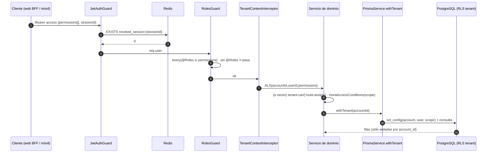
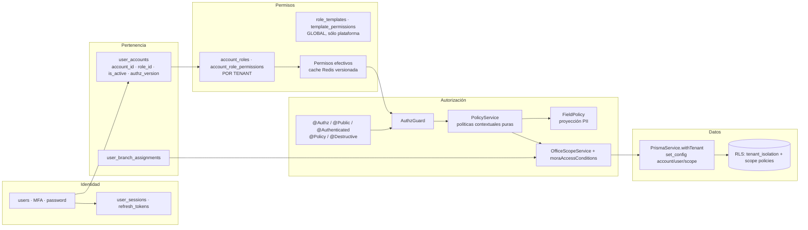
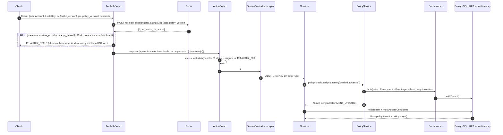
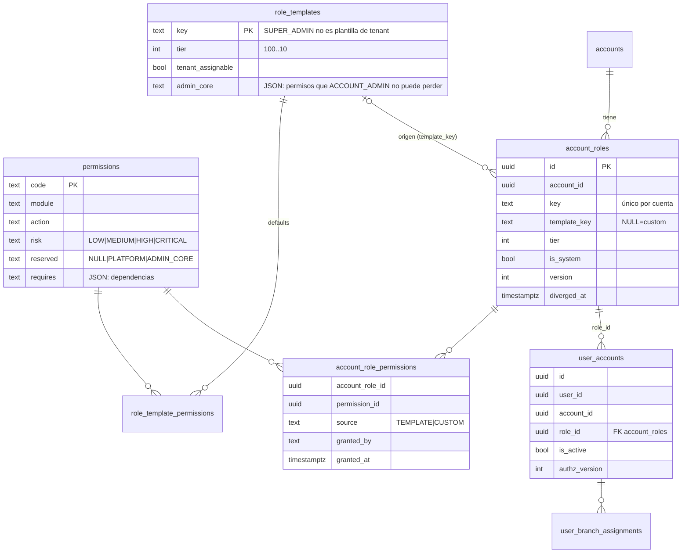
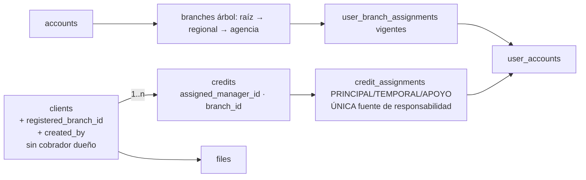
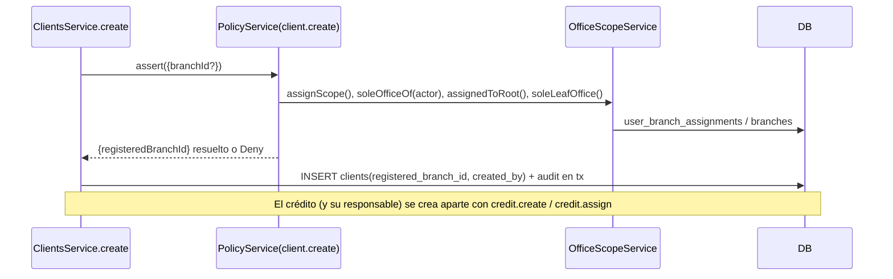
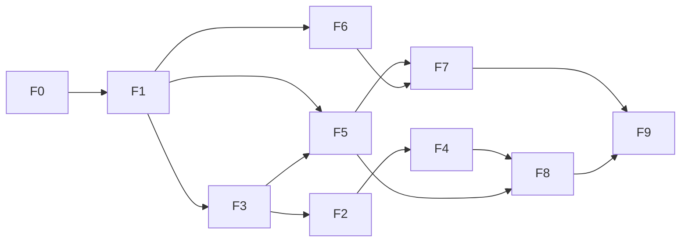

# F14 · Roles y permisos — plan de arquitectura e implementación

> **Fecha:** 2026-11-04 · **Rama:** `f14/roles-permisos` · **Tipo:** investigación + diseño. **No cambia código.**
> **Insumos:** [`ROLES-PERMISOS-AUDITORIA.md`](./ROLES-PERMISOS-AUDITORIA.md) (R-01…R-13) y [`ROLES-PERMISOS-ENDPOINTS.md`](./ROLES-PERMISOS-ENDPOINTS.md), **releídos contra el código** en esta sesión. Convenciones: `../_framework/README.md` (clases de evidencia §2, gates §4) y `TEMPLATES.md` (T1 hallazgos, T2 ADR, T4 plan de fase).
> **Regla de lectura:** toda afirmación lleva clase de evidencia. Lo VERIFICADO cita `archivo:línea` leído el 2026-11-04. Una PROPUESTA de este documento no autoriza código (RULES A2).

---

## A · Resumen ejecutivo

### A.1 El problema

Kobrax tiene un RBAC **plano y global**: 7 roles y 39 permisos en tablas sin `account_id`, los permisos viajan dentro del access token y el `RolesGuard` exige la conjunción de lo que declara `@Roles(...)`. Funciona como control de **capacidad** («¿puede hacer X?»), y F13 le añadió un motor de **alcance** por oficina («¿sobre qué filas?») resuelto por capacidad (`data:scope:*`). Lo que no existe, o existe a medias, es:

1. **Revocación**: un cambio de rol o una desactivación no mata la sesión viva (R-01, CONFIRMADO).
2. **Separación tenant ↔ plataforma**: `SUPER_ADMIN` = `ACCOUNT_ADMIN` (R-11, CONFIRMADO); no hay forma de que un administrador edite permisos sin afectar a todos los tenants (R-07, CONFIRMADO).
3. **Propiedad del cliente**: el cliente no tiene responsable ni oficina; sólo el crédito los tiene. Un cliente sin crédito vivo es visible para **toda la cuenta** (hallazgo nuevo N-12).
4. **Permisos declarados que no gobiernan nada**: `route:write/assign/execute` sólo en servicios (R-05), `client:pii:read` no se aplica al detalle (R-04), `credit:pii:read`, `role:write`, `client:import:replace` sin consumidor, y la tabla `user_permission_overrides` sin un solo lector (N-03).
5. **Segunda barrera inexistente**: las policies de RLS por alcance (`app_current_scope()`) **nunca se escribieron**; PostgreSQL sólo aísla por tenant (N-01). Todo el alcance intra-tenant depende de que cada consulta recuerde `moraAccessConditions`.

### A.2 Riesgos (por orden)

| # | Riesgo | Hallazgos |
|---|---|---|
| 1 | Persona degradada/desactivada opera hasta 15 min con poder viejo; un administrador que cambie permisos del rol (cuando exista el editor) no verá efecto hasta el refresh. | R-01, N-04 |
| 2 | Fuga intra-tenant: gerente regional ve y «suma a su oficina» personal de toda la cuenta; cualquier sesión del tenant lee cualquier archivo por nombre; clientes sin crédito visibles para todos. | R-02, R-06, N-12 |
| 3 | Un endpoint nuevo que olvide `tenant.can(...)` en el servicio queda abierto para `route:*`, agenda, castigo. No hay test de cobertura de las 202 puertas, sólo del «camino del cobrador». | R-05, N-08 |
| 4 | PII: quien lee un cliente lo ve entero; la decisión «¿quién ve CI/teléfono/dirección?» no está en ninguna capa. | R-04 |
| 5 | Imposible delegar administración sin tocar a todos los tenants. | R-07, R-11 |

### A.3 Arquitectura recomendada (resumen)

**RBAC por tenant + políticas contextuales + relaciones**, sin motor externo:

- **Identidad/auth** (ya existe: `users`, sesiones, refresh rotatorio, MFA) separada de **pertenencia** (`user_accounts`) y de **rol efectivo** (hoy `user_accounts.role_id`).
- **Roles por tenant materializados desde plantillas globales** (alternativa **C**, §4 de C.4): `account_roles` + `account_role_permissions` con linaje a la plantilla; `SUPER_ADMIN` edita plantillas, `ACCOUNT_ADMIN` edita las copias de su tenant con barandas. Un cambio global **nunca** toca una copia divergente.
- **Permisos efectivos** = filas del rol del tenant (una consulta, cacheada en Redis con versión). Los `user_permission_overrides` se **retiran** (H-4 aprobada: sin consumidor; migración de borrado tras verificar que no tiene filas).
- **Políticas contextuales** (TypeScript puro, testeable): `client.create`, `credit.create`, `credit.assign`, `member.invite`, `member.assignRole`, `role.editPermissions`, `file.read`, `pii.reveal`. Combinan permiso + alcance de oficina + relación (responsable, temporal, apoyo **del crédito**) + atributos (tenant de una sola oficina, raíz, jerarquía real de oficinas).
- **Responsabilidad en el crédito, no en el cliente** (H-7): el cliente guarda sólo **oficina de registro** y **creador**; su visibilidad se deriva de sus créditos (y, sin crédito vivo, del creador y del alcance de la oficina de registro). Perder el último crédito = perder el acceso al cliente.
- **Alcance** sigue siendo `OfficeScopeService` + `moraAccessConditions` (única fuente), extendido a Personas, Archivos y Clientes-sin-crédito, y **duplicado como policies RLS** de segunda barrera (`app.scope` ya viaja; faltan los `USING`).
- **Sesiones** (H-2): denylist por `sessionId` (ya existe) **+ `authz_version` por membresía + `policy_version` global** en el token, comprobados por request en un solo `MGET`; discrepancia → `401 AUTHZ_STALE`; refresh silencioso con **un** reintento; el refresh reconstruye permisos desde la fuente vigente; `revokeAll` al desactivar al usuario globalmente; invalidación sólo del contexto al desactivar una membresía; fail-closed y reconciliación DB↔Redis.
- **PII** por categoría y proyección central (`FieldPolicy`), no por endpoint; en el móvil el documento de identidad va **siempre enmascarado** y nunca se guarda completo offline (H-6).
- **Archivos** con fila propia (`files`) atada a entidad dueña y visibilidad derivada del alcance de esa entidad.
- **Plataforma** (H-11): **un único `SUPER_ADMIN`** aprovisionado por infraestructura (sin API ni UI para crearlo/editarlo/promover), **interruptor externo** `PLATFORM_ACCESS_ENABLED` (+ opcional `SUPPORT_WRITE_ENABLED`) en manos de la persona dueña de Kobrax, sesiones de soporte acotadas y trazadas, y escritura sensible sólo con **consentimiento del `ACCOUNT_ADMIN` del tenant**.

### A.4 Decisiones (las preguntas H-1…H-12 fueron **aprobadas por la usuaria el 2026-11-04**, ver §H; los ADR formales T2 se redactan en Fase 0 citando esa aprobación)

| ADR | Decisión | Decisión H que la respalda | Sección |
|---|---|---|---|
| ADR-F14-01 | Roles por tenant materializados con linaje (Alt. C); edición de plantillas copiadas en F7; creación de roles custom en fase posterior (mientras tanto, operación de plataforma) | H-1, H-9 | C.4 |
| ADR-F14-02 | Revocación: denylist + `authz_version` (membresía) + `policy_version` (global) validados por request; `AUTHZ_STALE`; `revokeAll` en desactivación global; invalidación de contexto en desactivación de membresía; fail-closed con reconciliación DB↔Redis | H-2 | C.6 |
| ADR-F14-03 | Decorador único `@Authz` con AND/OR + `@Public`/`@Authenticated` explícitos + test de cobertura total (deny-by-default verificable) | — (técnica) | C.2 |
| ADR-F14-04 | La responsabilidad vive en el **crédito** (`credit_assignments`); el cliente sólo lleva `registered_branch_id` y `created_by`; visibilidad del cliente derivada de sus créditos | H-7 | C.8 |
| ADR-F14-05 | `client:create` / `credit:create` separados de `*:write`; `client:delete` aparte, destructivo y lógico; políticas `client.create`/`credit.create` por contexto organizacional; `member.invite` con rol estrictamente inferior; `credit.assign` con pares sólo en oficina hija | H-3, H-8, H-12 | D, C.8 |
| ADR-F14-06 | PII por categoría: conservar `client:pii:read`, redefinir `credit:pii:read`, añadir `client:contact:read`; `pii.reveal` auditado para el supervisor; CI siempre enmascarado en móvil | H-6 | C.7 |
| ADR-F14-07 | Tabla `files` + enlaces firmados temporales | — (técnica) | C.7 |
| ADR-F14-08 | Plataforma: único `SUPER_ADMIN` de infraestructura, interruptor externo, sesiones de soporte con consentimiento del `ACCOUNT_ADMIN` para escritura sensible, `actor_type` en auditoría | H-11 | C.5 |
| ADR-F14-09 | Navegación: secciones Cuenta / Organización / Equipo / Seguridad / Actividad con permiso propio; AUDITOR y VIEWER asignables desde la web, fuera del móvil | H-5 | E (Fase 6) |
| ADR-F14-10 | Retirar `user_permission_overrides` | H-4 | C.10 |
| ADR-F14-11 | Móvil: ventana offline 8 h (cobrador) / 2 h (`assignment:write`, `user:write`); validación al reconectar e informe de rechazos | H-10 | E (Fase 8) |

### A.5 Orden recomendado

Fase 0 Descubrimiento residual → **Fase 1 Sesiones y aislamiento** (R-01, R-02, R-06 mínimo, N-12) → **Fase 3 Arquitectura central** (decoradores, policy service, cobertura 202) → **Fase 2 Modelo organizacional y alcance** (cliente con dueño, `client:create`, RLS 2ª barrera) → Fase 4 PII y archivos → Fase 5 Roles por tenant → Fase 6 Frontend/navegación → Fase 7 Administración de roles (editor) → Fase 8 Móvil/offline → Fase 9 Auditoría integral y despliegue. Se reordena 3 antes de 2 porque el modelo organizacional necesita el `PolicyService` para expresar `client.create` sin repetir `if` por servicio (justificación en E).

---

## B · AS-IS (estado real, verificado 2026-11-04)

### B.1 Componentes

| Capa | Pieza | Evidencia (VERIFICADO) | Rol real |
|---|---|---|---|
| Auth | `JwtAuthGuard` | `apps/api/src/modules/auth/guards/jwt-auth.guard.ts:31-53` | Verifica firma, rechaza `type≠access`, consulta denylist `revoked_session:{sessionId}` en Redis, adjunta `{userId, accountId, roleId, permissions, sessionId}` a `req.user`. |
| Authz | `RolesGuard` | `roles.guard.ts:16-33` | `getAllAndOverride(ROLES_KEY,[handler,class])`; **sin metadatos → pasa** (línea 21); exige **todos** los permisos (`every`, línea 25). |
| Authz | `@Roles(...)` | `decorators/roles.decorator.ts:3-10` | `SetMetadata('required_permissions', [...])`. Sólo AND. No existe `@Public` ni `@Authenticated`: «público» = controlador sin `@UseGuards`; «solo sesión» = guards sin `@Roles`. |
| Tenant | `TenantGuard` | `tenant.guard.ts:13-19` | Sólo comprueba que `req.user.accountId` exista. **No** valida pertenencia del recurso (CONTRADICTORIO con `apps/api/src/modules/auth/CLAUDE.md` «TenantGuard (validación de recursos)»; manda el código). |
| Contexto | `TenantContextInterceptor` → `TenantContextService` | `common/context/tenant-context.interceptor.ts:29-51`, `tenant-context.service.ts:28-62` | AsyncLocalStorage con `accountId, userId, permissions, sessionId, ip, userAgent, appVersion`; `can(p)` = `permissions.includes(p)`. |
| Datos | `PrismaService.withTenant` | `database/prisma.service.ts:78-101, 130-146` | Transacción con `set_config('app.current_account_id' / 'app.current_user_id' / 'app.scope')`. Scope = `account` si `data:scope:all` **o** `data:scope:subtree`; si no, `own`. `withSystemTenant` (3 llamadores: `prisma.service.ts`, `auth.service.ts:384`, `account-requests.service.ts`). |
| RLS | `001_enable_rls.sql` | `packages/database/prisma/rls/001_enable_rls.sql:21-85` | Policy `tenant_isolation` (`account_id = app_current_account()`) en ~45 tablas; `accounts` por id; `user_permission_overrides` con `account_id IS NULL OR …`. |
| RLS | `002_scope.sql` | `002_scope.sql:7-10, 38-51` | **Sólo helpers** (`app_current_user`, `app_current_scope`, `app_scope_sees_all`). «Las policies llegan en F2» — no llegaron: `grep app_current_scope` sólo da este archivo. |
| Alcance | `OfficeScopeService` / `office-scope.ts` | `common/office-scope/office-scope.ts:20-25, 66-71`; `office-scope.service.ts:59-66, 122-136` | Tipo de alcance por capacidad (`ALL>SUBTREE>BRANCH>OWN`), SQL de subárbol por `user_branch_assignments`, `assignScope`, `resolveCreditBranch` (la oficina del crédito la decide el servidor). |
| Alcance | `moraAccessConditions` / `visibleCreditIdsSql` / `visibleClientIdsSql` | `modules/mora/mora-query.ts:131-144, 164-178` | Única regla de visibilidad de créditos; clientes = clientes con crédito visible **∪ clientes sin crédito vivo**. |
| Permisos | `PermissionsService.forRole` | `auth/permissions.service.ts:13-19` | `role_permissions` global por `roleId`. Comentario: overrides «Slice 4» (no existe). |
| Tokens | `TokenService` | `auth/token.service.ts:7-13, 37-51, 77-91` | Access 15 min con `permissions[]`; refresh 7 d con `jti` hasheado, familia y sesión. |
| Sesiones | `SessionService` | `auth/session.service.ts:41-47, 72-107` | Denylist Redis (TTL 7 d); `revokeOne`/`revokeAll(userId, except?)` vía `auth_user_sessions` SECURITY DEFINER (`003_session_functions.sql:11-42`). |
| Emisión | `AuthService.issueTokens` / `refresh` / `switchAccount` | `auth/auth.service.ts:430-485, 488-578, 183-234` | Login → permisos del rol de la membresía; refresh relee `user_accounts.isActive` y recalcula permisos (533-537); `switchAccount` revoca la sesión anterior (208). |
| Catálogo | `Permission` enum / `ROLE_PERMISSIONS` | `packages/shared/src/enums/permission.enum.ts:13-113`; `constants/permissions.ts:15-132` | 39 permisos; `SUPER_ADMIN` y `ACCOUNT_ADMIN` = `Object.values(Permission)` (16-18). Seed consume el mapa (`seed.ts:1859-1874`). |
| Roles | `Role`, `RolePermission`, `UserPermissionOverride`, `UserAccount`, `UserBranchAssignment` | `schema.prisma:285-379, 204-224` | `Role.name @unique` **global**; `UserBranchAssignment.roleId` siempre `NULL` (ADR-0002); `UserAccount.branchId` es **espejo** de la asignación (`users.service.ts:138-156`). |
| Auditoría | `AuditService` + `redactPII` | `common/audit/audit.service.ts:33-61`; `redact.ts:8-24` | Append-only por tenant, con `userId` del contexto; redacta claves PII en snapshots. Falla en silencio (log). |
| Web | BFF + `middleware.ts` + `(panel)/layout.tsx` + `PermissionsProvider` | `apps/web/src/middleware.ts:70-144, 159-195`; `app/(panel)/layout.tsx:26-29, 69`; `components/permissions.tsx:11-31`; `lib/nav.ts:72-77`; `lib/cuenta-tabs.ts:33-36` | Cookies httpOnly; refresh silencioso en middleware; `/auth/me` por request en el layout → `visibleNav` + contexto `can()`; cada página decide con `permissions.includes(...)` ad hoc. |
| Móvil | `session.ts`, `auth-service.ts`, `api-client.ts`, `permissions.ts` | `apps/mobile/src/session.ts:13-18, 34-61, 105-124`; `auth-service.ts:80-84, 205-232`; `api-client.ts:17-29, 52-75`; `permissions.ts:11-23` | Tokens en SecureStore; `me` (con `permissions`) cacheado en SQLite `session/me`; ventana offline 8 h; refresh single-flight con `clearSession` si el servidor rechaza. Tabs **no** filtradas por permiso (`app/(tabs)/_layout.tsx`: sin `can`/`permissions`). |

### B.2 Flujos actuales



Hechos del flujo:
- La identidad y los permisos del request **salen íntegros del JWT**; la base no se consulta para autorizar (VERIFICADO `jwt-auth.guard.ts:45-51`).
- La única revocación por request es la denylist por `sessionId` (`:43`). Nadie la alimenta al cambiar rol/estado (`users.service.ts:158-253` no llama a `SessionService`).
- `app.scope` se fija pero **nadie lo lee** en PostgreSQL (N-01).

### B.3 Multi-tenant y alcance

- Aislamiento entre tenants: RLS `tenant_isolation` + `kobrax_app` sin `BYPASSRLS` (`001_enable_rls.sql:8-9, 79-83`). Correcto. Las tablas globales (`users, profiles, roles, permissions, role_permissions`) van sin RLS (`:104-107`).
- Alcance intra-tenant: 100 % en la aplicación. Consumidores de la regla única: Mora, Agenda, Cartera, Clientes, Pagos, Exportes (`exports.service.ts:49-62, 248`), Analítica, Oficinas, Asignaciones, Importaciones (INFERIDO de la auditoría §5 + VERIFICADO en `clients.service.ts:135-148, 371-427`).
- **Fuera de alcance**: `GET /users*` (`users.service.ts:69-75`: «sin where de tenant: lo pone la RLS» — y nada más), `GET /uploads/:name` (`uploads.controller.ts:25-28`), clientes sin crédito vivo (`mora-query.ts:173-178`).
- Transacciones: `withTenant` abre **una transacción por llamada**; `AuditService` abre la suya (`audit.service.ts:41`): la auditoría puede quedar escrita aunque la operación haga rollback, o perderse si falla Redis/DB después del commit (INFERIDO del orden de llamadas en `clients.service.ts:272-276`).

### B.4 Hallazgos de la auditoría, verificados

| # | Veredicto | Evidencia (VERIFICADO 2026-11-04) | Precisión |
|---|:-:|---|---|
| R-01 | **CONFIRMADO** | `users.service.ts:158-253` (updateMember) no invoca `SessionService`; `jwt-auth.guard.ts:43` sólo `isRevoked(sessionId)`; permisos en claims `token.service.ts:7-13`. El refresh sí relee `isActive` y rol (`auth.service.ts:533-537`) → ventana ≤ 15 min. `switchAccount` sí revoca (`auth.service.ts:208`). | Cambio de contraseña revoca todas: INFERIDO (comentario en `apps/mobile/src/auth-service.ts:247-248`; `password.service.ts` no leído). |
| R-02 | **CONFIRMADO** | `users.service.ts:69-75`; también `GET /users/:id`, `/activity`, `/activity/events` con `user:read` sin alcance (anexo). `assignableRows` (`assignment.service.ts:139-151`) sí recorta por oficina pero sólo para reparto. | — |
| R-03 | **CONFIRMADO (redefinido por H-7)** | `Client` sin oficina ni creador (`schema.prisma:658-722`); `clients.service.ts:189-206` no los escribe; el crédito sí tiene `assignedManagerId` + `branchId` + `credit_assignments` (`schema.prisma:879, 891, 1058-1089`; `credits.service.ts:260-262, 292, 314`). SUPERVISOR sin `client:write`/`credit:write` (`permissions.ts:53-79`). | La responsabilidad **del crédito** está resuelta y bien hecha y, por H-7, **es la única**: el cliente no tendrá cobrador dueño. Lo que falta es `registered_branch_id` + `created_by` en el cliente, derivar su visibilidad de sus créditos (cierra N-12) y dar `client:create`/`credit:create` al supervisor. |
| R-04 | **CONFIRMADO** | `clients.controller.ts:75-83`: `reveal=true` sólo audita (`clients.service.ts:599-603`); `client:pii:read` únicamente en `portfolio-import.controller.ts:155`; `credit:pii:read` sin ninguna referencia en `apps/` (grep). Teléfonos/direcciones del cobrador salen por `agenda/clients/:id/context` (`agenda.service.ts:781`, `routes.service.ts:712`). | — |
| R-05 | **CONFIRMADO** | `routes.controller.ts:34-60` y `field.controller.ts:35-45`: POST con `@Roles(ROUTE_READ)`; la decisión real en `routes.service.ts:186-201, 1101-1118`, `field.service.ts:224-225, 409-410`, `route-access.ts:46-47`. Mismo patrón: `agenda.service.ts:189` (`agenda:assign`), `credits.service.ts:745-751` (castigo), `dashboards.service.ts:54,70`. | El test `permission-gates.spec.ts` cubre 13 controladores y sólo el «camino del cobrador»; no verifica deny-by-default. |
| R-06 | **CONFIRMADO** | `uploads.controller.ts:14-29` sin `@Roles`; `uploads.service.ts:96-104, 130-135`: nombre = `sha256.ext` en carpeta del tenant; no hay fila en DB que ate archivo→entidad (`ClientAttachment.fileUrl` sólo guarda la URL, `schema.prisma:857-872`); auditoría sólo en `CREATE`. La web proxya `/api/uploads/:path*` (`middleware.ts:194`). | Un hash no es control: quien ve la URL en cualquier respuesta (foto de fachada, QR de perfil) la puede compartir con cualquier sesión del tenant. |
| R-07 | **CONFIRMADO** | `roles.controller.ts:15-19` sólo `GET`; `listRoles` filtra `MOBILE_ROLES` (`users.service.ts:469-474`); `Role.name @unique` global (`schema.prisma:285-299`); `role:write` 0 endpoints (anexo). | — |
| R-08 | **CONFIRMADO** | Anexo: `POST /dashboards` = `report:read`; `dashboards.service.ts:54,70` exige `account:write` sólo para ajenos. COLLECTOR tiene `report:read` desde 2026-11-04 (`permissions.ts:102`). | Controlador no releído: evidencia del servicio + anexo. |
| R-09 | **CONFIRMADO** | `roles.ts:11` `MOBILE_ROLES`; `users.service.ts:169, 269` (`isMobileRole`) rechazan AUDITOR/VIEWER por API. | — |
| R-10 | **CONFIRMADO** | `nav.ts:57` (`account` exige `ACCOUNT_READ`); `cuenta-tabs.ts:22,24`; `cuenta/layout.tsx:24-30` devuelve `noAccess` si `GET /accounts/me` falla → el supervisor no puede llegar ni por URL. | — |
| R-11 | **CONFIRMADO** | `permissions.ts:16-18`; `mfa-policy.ts:13`; `PermissionScope.GLOBAL` sin uso (`permission.enum.ts:3`); **todas** las filas de `permissions` tienen `scope @default(GLOBAL)` (`schema.prisma:310`) → la columna no significa nada (N-02). | — |
| R-12 | **CONFIRMADO** | MANAGER sin `USER_INVITE` (`permissions.ts:19-52`); `POST /users/invite` exige `user:invite` (anexo). | — |
| R-13 | **CONFIRMADO** | `assignment-rules.ts:34, 41-44`: destinatarios = `COLLECTOR | SUPERVISOR | uno mismo`; `agencyViolations` sólo mira subárbol de oficinas, no jerarquía de roles. Además un MANAGER asignado a la raíz obtiene `ALL` (`office-scope.service.ts:64`) y puede asignar a cualquier supervisor de la cuenta. | — |

### B.5 Hallazgos nuevos (T1)

```
### H-F14-N01 · RLS de alcance intra-tenant no existe
- Clase: VERIFICADO (CONTRADICTORIO con F13/RULES B14, que dice «RLS solo distingue account y own»)
- Evidencia: packages/database/prisma/rls/002_scope.sql:7-10 («las policies llegan en F2»); grep app_current_scope → sólo ese archivo; prisma.service.ts:93-101 fija app.scope   (2026-11-04)
- Hecho: PostgreSQL no lee app.scope ni app.current_user_id en ninguna policy.
- Implica: no hay segunda barrera; «fail-closed por construcción» (prisma.service.ts:10-14) es aspiracional.
- HUB: —
```
```
### H-F14-N02 · permissions.scope siempre GLOBAL
- Clase: VERIFICADO
- Evidencia: schema.prisma:310; seed.ts:1849 (upsert sin scope)
- Hecho: la columna existe y no se usa; `PermissionScope` sólo se reutiliza como vocabulario de `DataScope`.
- Implica: el catálogo propuesto (D) define alcance por permiso de verdad; la columna se repuebla o se elimina.
```
```
### H-F14-N03 · user_permission_overrides sin consumidor
- Clase: VERIFICADO
- Evidencia: grep userPermissionOverride en apps/ → sólo mora-scope-presets.spec.ts; permissions.service.ts:7 («Slice 4»)
- Hecho: tabla + policy RLS + relación en User, nunca leída ni escrita.
- Implica: decidir retirar (recomendado) o adoptar con caso real (H-4).
```
```
### H-F14-N04 · Permisos congelados en el JWT
- Clase: VERIFICADO
- Evidencia: token.service.ts:7-13, 37-42; jwt-auth.guard.ts:45-51
- Hecho: cualquier cambio de permisos de un rol tarda hasta 15 min por persona, y nada lo acelera.
- Implica: el editor de permisos (R-07) sin revocación/versionado (C.6) sería inseguro.
```
```
### H-F14-N05 · ROLE_PERMISSIONS (código) decide en runtime
- Clase: VERIFICADO
- Evidencia: apps/api/src/modules/notifications/realtime.helpers.ts:1,22-26 (destinatarios por rol); web nav.test.ts, cuenta-tabs.test.ts, mora.test.ts
- Hecho: la matriz estática se usa para decidir destinatarios de notificaciones y en tests de UI.
- Implica: con roles por tenant, ese helper queda desincronizado; debe derivar de permisos efectivos.
```
```
### H-F14-N06 · Móvil: identidad y permisos cacheados 8 h sin revalidación
- Clase: VERIFICADO (consecuencia offline: DESCONOCIDO)
- Evidencia: session.ts:34-50 (validUntil = min(7d, 8h)); auth-service.ts:80-84, 205-232 (meLocal, db.putOne('session','me'))
- Hecho: sin red, la app arranca con el último `me` (permisos incluidos) hasta 8 h; si al reconectar el servidor devuelve 401 tras refresh → clearSession (api-client.ts:72-75).
- Implica: rol cambiado/desactivado estando offline → la UI ofrece acciones que el servidor rechazará; qué hace la cola con un 403 → DESCONOCIDO (no se leyó `sync/queue`). Pregunta a resolver en Fase 8.
```
```
### H-F14-N07 · Tabs móviles sin gating por permiso
- Clase: VERIFICADO
- Evidencia: apps/mobile/app/(tabs)/_layout.tsx (grep `permissions|can(` sin resultados); `mas.tsx:27` sólo oculta Importar
- Hecho: las 5 pestañas se dibujan para todos los roles.
```
```
### H-F14-N08 · Web: no hay guard de ruta; cada página improvisa
- Clase: VERIFICADO
- Evidencia: (panel)/layout.tsx:69-84 (sólo filtra nav); cuenta/layout.tsx:28-30 (depende del 403 de la API); rutas/planificar/page.tsx:49 (redirect por permiso); dashboard/page.tsx:78-80 (redirect)
- Hecho: tres estrategias distintas; una página nueva sin check queda abierta visualmente (la API sigue protegiendo).
```
```
### H-F14-N09 · TenantGuard no valida recursos
- Clase: VERIFICADO (CONTRADICTORIO con apps/api/src/modules/auth/CLAUDE.md)
- Evidencia: tenant.guard.ts:13-19
- Hecho: sólo exige accountId en el token. La pertenencia la garantiza RLS + `withTenant`.
- Implica: corregir la doc; el diseño no debe apoyarse en un TenantGuard que no existe.
```
```
### H-F14-N10 · Doble verdad de la oficina de la persona
- Clase: VERIFICADO
- Evidencia: schema.prisma:362 (`UserAccount.branchId`), 204-224; users.service.ts:138-156 (syncAssignment) y 225-229 (escribe las dos)
- Hecho: `user_accounts.branch_id` es espejo manual de `user_branch_assignments`.
- Implica: la política de asignación debe leer SÓLO asignaciones (ya lo hace OfficeScopeService); el espejo es deuda.
```
```
### H-F14-N11 · Auditoría fuera de la transacción
- Clase: VERIFICADO
- Evidencia: audit.service.ts:41-55 (withTenant propio); assignment.service.ts:77-79 («la auditoría va DESPUÉS del commit»)
- Hecho: una mutación puede quedar sin rastro si el proceso cae entre commit y audit; o auditarse un rollback si se llama dentro.
- Implica: los cambios de permisos/roles (alto riesgo) deben auditarse EN la misma transacción (`tx.auditLog.create`).
```
```
### H-F14-N12 · Cliente sin crédito vivo visible para toda la cuenta
- Clase: VERIFICADO
- Evidencia: mora-query.ts:168-178; F13/STATUS.md:47 lo reconoce
- Hecho: el UNION entrega a cualquier cobrador todos los clientes sin crédito de la cuenta (con sus contactos, vía /clients/:id).
- Implica (H-7): el segundo término del UNION pasa a «creador = yo OR oficina de registro dentro de mi alcance».
```
```
### H-F14-N13 · DTOs aceptan branchId/userId del cliente
- Clase: PARCIAL (VERIFICADO en créditos; NO VERIFICADO en filtros)
- Evidencia: dto grep (analytics.dto.ts:36, mora.dto.ts:53, routes/route.dto.ts:33,51, clients/client.dto.ts:247, branches/branch.dto.ts:48); credits usa assertBranchUsable (office-scope.service.ts:88-94)
- Hecho: la oficina del crédito se valida contra el alcance. Si los filtros `branchId` de analítica/mora/rutas se INTERSECAN con el alcance o lo reemplazan no se verificó.
- Implica: Fase 0 lo lee; Fase 3 lo cubre con test «branchId fuera de alcance ⇒ 404/vacío».
```
```
### H-F14-N14 · Role.level sin función de jerarquía
- Clase: NO VERIFICADO
- Evidencia: schema.prisma:289; users.service.ts:471 (sólo orderBy)
- Hecho: existe un nivel numérico; la regla «nunca hacia arriba» no lo usa (usa oficinas). Confirmar en Fase 0 si algún otro consumidor lo lee.
```

---

## C · TO-BE (arquitectura objetivo)

### C.1 Separación de responsabilidades



Reparto por capa (backend):

| Capa | Hace | No hace |
|---|---|---|
| **Guards** (`JwtAuthGuard`, `AuthzGuard`) | Autenticación, revocación (denylist + versión), permisos estáticos AND/OR, deny-by-default. | Mirar filas de dominio. |
| **Decoradores** | Declarar el contrato de cada handler: `@Public()`, `@Authenticated()`, `@Authz({all,any})`, `@Policy('credit.assign')`, `@Destructive()`. | Lógica. |
| **Interceptores** | `TenantContextInterceptor` (contexto ALS, extendido con `roleKey`, `authzVersion`, `actorType`), `AuditInterceptor` (mutaciones), `PiiProjectionInterceptor` (aplica `FieldPolicy` a la respuesta serializada cuando el handler declara `@PiiFields(...)`). | Autorizar. |
| **Pipes** | Validación de DTO; `ParseUUIDPipe`. Prohibido aceptar `accountId`/`userId` del actor en body (lint + test). | — |
| **Contexto** | `TenantContextService`: identidad + permisos efectivos + alcance resuelto (memo por request). | — |
| **`AuthorizationService` (policy central)** | `can(p)`, `canAny`, `assert(p)`, `policy(name).check(input)`, `scope()`; una sola API consumida por servicios. Políticas = funciones puras `(ctx, facts) → Allow | Deny(code)` con *facts* cargados por un `FactsLoader` (oficinas del actor, oficina del recurso, responsable, es cuenta de una sola oficina). | Acceder a Prisma directamente (lo hace el loader). |
| **Servicios de dominio** | Reglas de negocio; piden a `AuthorizationService` la decisión contextual; nunca comparan `role.name` (salvo política explícita). | `tenant.can(...)` disperso. |
| **Capa de datos** | `withTenant` obligatorio; filtros de alcance por `moraAccessConditions`/`officeVisibilitySql`; RLS como segunda barrera. | Confiar en que la app filtró. |

### C.2 API de decoradores y deny-by-default verificable (ADR-F14-03)

```ts
// apps/api/src/modules/auth/decorators/authz.decorator.ts (propuesto)
export const AUTHZ_KEY = 'authz';
export type AuthzSpec =
  | { kind: 'public' }
  | { kind: 'authenticated' }                       // sesión válida, sin permiso (perfil propio, notificaciones)
  | { kind: 'permissions'; all?: string[]; any?: string[]; policy?: string; destructive?: boolean };

export const Public = () => SetMetadata(AUTHZ_KEY, { kind: 'public' });
export const Authenticated = () => SetMetadata(AUTHZ_KEY, { kind: 'authenticated' });
export const Authz = (spec: Omit<Extract<AuthzSpec,{kind:'permissions'}>,'kind'>) => SetMetadata(AUTHZ_KEY, { kind: 'permissions', ...spec });
export const Roles = (...all: string[]) => Authz({ all });   // compatibilidad: 202 handlers no se reescriben de golpe
```

- `AuthzGuard` (sustituye a `RolesGuard`, registrado **global** con `APP_GUARD` junto a `JwtAuthGuard`): sin metadatos en handler ni clase → **403 `AUTHZ_000` (deny by default)**. `public` → salta JWT. `authenticated` → sólo JWT. `permissions` → `all` (AND) y `any` (OR) sobre permisos efectivos; `policy` se evalúa después, en el servicio (el guard no tiene el recurso) pero el metadato permite **auditar que existe**. `destructive` exige cabecera `x-confirm: <token>` o cuerpo `{ confirm: true }` y produce auditoría con `risk: HIGH`.
- **Test de cobertura total** (`authz-coverage.spec.ts`): con `DiscoveryService` + `MetadataScanner` enumera todos los controladores y handlers HTTP del `AppModule`; afirma que cada uno tiene exactamente un `AUTHZ_KEY` resuelto; genera una tabla `metodo | ruta | kind | all | any | policy` y la compara con `docs/epics/F14/authz-snapshot.json` (snapshot aprobado). Cambiar una puerta = cambiar el snapshot en el mismo PR. Cubre los 202 (+ los nuevos). Reemplaza y amplía `permission-gates.spec.ts` (que se conserva como regresión funcional).
- **Permisos «sólo servicio»** (R-05): el metadato pasa a ser la verdad: `POST /routes` → `@Authz({ any: ['route:execute','route:write','route:assign'] })`; `POST /routes/generate` igual; `PATCH /routes/:id` igual; `POST /visits` → `any: ['route:execute','route:assign','route:write']`; `GET /agenda/assignees` ya exige `agenda:assign`; `POST /credits/:id/write-off` → `all: ['credit:write'], policy: 'credit.writeOff'`; `POST /dashboards` → `dashboard:write`. El servicio conserva **sólo** la decisión fina (para quién, sobre qué fila).
- **Rutas que confían en ids del cliente** (N-13): regla lint `no-actor-ids-in-dto` (un `@IsUUID() accountId|userId` en un DTO de entrada falla salvo lista blanca: `assigneeId`, `collectorId`, `reassignToUserId`, `branchId`), y test «filtro `branchId` fuera de alcance ⇒ vacío/404» para `/mora`, `/analytics/*`, `/routes`, `/clients`.
- `role:write` pasa a exigirse en los endpoints nuevos de Fase 7 (`PUT /roles/:key/permissions`, etc.).

### C.3 Flujo de autorización objetivo



Qué se comprueba por petición, qué se cachea:

| Comprobación | Dónde | Costo | Caché / invalidación |
|---|---|---|---|
| Firma y expiración del JWT | `JwtAuthGuard` | CPU local | — |
| Sesión revocada | Redis `revoked_session:{sid}` | 1 GET (ya existe) | TTL 7 d |
| Versión de autorización de la membresía (`av`) | Redis `authz:{userId}:{accountId}` | mismo round-trip (`MGET`) | Se escribe tras el commit que cambia rol/estado/oficina/permisos del rol; si falta → se lee de `user_accounts.authz_version` y se cachea; si Redis no responde → 401 (fail-closed) |
| Versión global de políticas (`pv`) | Redis `policy_version` (espejo de `platform_settings.policy_version`) | mismo `MGET` | Se incrementa al cambiar el catálogo de permisos, una plantilla o hacer un rollout; si falta → se lee de DB |
| Permisos efectivos del rol | Dentro del JWT (H-2); el refresh los **reconstruye** desde `account_role_permissions` y nunca copia los del token anterior | 0 | Caché Redis `perm:{accountId}:{roleKey}:{roleVersion}` sólo para el refresh (clave versionada: nunca se invalida, se abandona) |
| Alcance (oficinas del actor) | `OfficeScopeService` (memo por request) | 1 consulta por request que lo use | Sin caché (cambia con asignaciones) |
| Políticas contextuales | `PolicyService` | consultas acotadas por `FactsLoader` | Sin caché |

### C.4 Modelo de roles por tenant (ADR-F14-01)

**Comparación**

| Criterio | A · Globales + overrides por tenant | B · Roles independientes por tenant | **C · Plantilla global + copias por tenant con linaje** |
|---|---|---|---|
| Aislamiento | Débil: un cambio en `role_permissions` global llega a todo tenant que no haya «overrideado» ese permiso. | Total. | **Total**: la copia es del tenant; la plantilla sólo se usa al crear la cuenta y en *rollouts* explícitos. |
| Escalabilidad | Pocas filas. | N×7 roles × ~40 permisos = 280 filas/tenant: trivial (1 000 tenants → 280 k filas, una tabla indexada). | Igual que B. |
| Complejidad de cálculo | Alta: efectivos = base − denegados + concedidos; dos fuentes, orden de precedencia, casos de borde (override de un permiso que la base dejó de tener). | Mínima: `SELECT permission FROM account_role_permissions WHERE account_role_id = ?`. | **Mínima** (igual que B) + columna `source` para saber qué divergió. |
| Migración | Pequeña (tabla nueva). | Una migración que clona 7×N roles y **reapunta `user_accounts.role_id`**. | Igual que B, pero conserva `template_key` → se puede volver atrás por tenant. |
| Compatibilidad con código actual | `roleId` global sigue valiendo. | `roleId` cambia de significado (FK a `account_roles`); JWT, `MOBILE_ROLES`, `mfa-policy`, `assignment-rules`, `realtime.helpers` comparan `role.name` → todos pasan a `roleKey` (= `template_key`). | Igual que B. Es trabajo real pero **finito**: 7 archivos (grep `role.name`/`RoleType`). |
| Rendimiento | Dos consultas o un `LEFT JOIN` por refresh. | Una consulta. | Una consulta. |
| Auditoría | Diff contra una base móvil (si la base cambia, el historial del tenant cambia de sentido). | El historial es del tenant. | **El historial es del tenant** y además se sabe si la fila vino de la plantilla o de un admin. |
| Permiso nuevo de plataforma | Automático (y por eso peligroso). | Hay que *rollout* explícito a N tenants. | *Rollout* explícito: job que inserta en cada tenant **sólo** donde `source='TEMPLATE'` y el rol no está marcado `diverged_at` para ese módulo; lo demás queda como el admin lo dejó. Operación auditada y reversible. |
| Roles personalizados futuros | Tercera estructura. | Nativo: un `account_role` sin plantilla. | **Nativo**: `template_key NULL`. |
| Tenant FREE individual (C2) | Sin cambios. | Copias creadas al registrarse; nada que configurar. | Idem. |

**Recomendación: C.** A viola «un cambio global no altera un tenant por accidente»; B pierde la relación con la plantilla y hace imposible un rollout prudente. C es B con memoria.

**Modelo lógico**



- **Permisos efectivos** de una persona = `account_role_permissions` de `user_accounts.role_id` (del tenant del token). `data:scope:*` es excluyente: constraint `CHECK`/trigger «como máximo un `data:scope:*` por `account_role`».
- **`roleKey`** (= `account_roles.key`, igual a `template_key` para los del sistema) sustituye a `role.name` en el JWT y en todo `switch` por rol (`MOBILE_ROLES`, `CRITICAL_ROLES`, `ASSIGNABLE_ROLES`, `realtime.helpers`). Los roles personalizados declaran `tier` y «hereda comportamiento de» (`behaves_like: 'SUPERVISOR'`) para esas listas, hasta que cada una se reescriba por capacidad.
- **Cómo un cambio global no toca un tenant por accidente**: (1) la plantilla no se consulta en runtime; (2) el rollout de un permiso nuevo es un comando explícito de plataforma (`platform:roles:rollout`) con *dry-run* que lista tenants afectados, y sólo inserta filas `source='TEMPLATE'` en roles sin `diverged_at` en ese módulo; (3) toda inserción queda auditada con `actor_type='PLATFORM'`; (4) un tenant puede «restaurar plantilla» por rol (acción del admin, auditada), nunca al revés.
- **`SUPER_ADMIN`** deja de ser plantilla de tenant: pasa a `platform_roles` (C.5). `ACCOUNT_ADMIN`, `MANAGER`, `SUPERVISOR`, `COLLECTOR`, `AUDITOR`, `VIEWER` son plantillas.

### C.5 Plataforma vs tenant (R-11, ADR-F14-08, decisión H-11)

```mermaid
flowchart TB
  INF[Infraestructura<br/>seed/CLI aprovisiona UN platform_user SUPER_ADMIN<br/>PLATFORM_ACCESS_ENABLED · SUPPORT_WRITE_ENABLED]
  PU[platform_users: 1 fila SUPER_ADMIN<br/>MFA obligatorio · sin membresía en tenants<br/>sin API ni UI de alta/edición/promoción]
  SS[support_sessions<br/>account_id · reason · ticket · expires_at ≤ 240 min · permissions_subset<br/>consent_status · consent_by (ACCOUNT_ADMIN) · consent_at]
  INF --> PU
  PU -->|sólo si PLATFORM_ACCESS_ENABLED| SS
  SS -->|JWT actor_type=PLATFORM, supportSessionId, permissions ⊆ subset| API
  API -->|escritura sensible sólo si SUPPORT_WRITE_ENABLED y consent_status=GRANTED| T[(tenant)]
  API -->|audit_logs.actor_type + support_session_id| AUD[(audit_logs)]
  API -->|banner «Sesión de soporte · vence HH:MM»| WEB
```

- **Un único `SUPER_ADMIN`**: `platform_users` tiene exactamente una fila, creada por seed/infraestructura (`packages/database/prisma/seed.ts` + variable `PLATFORM_ADMIN_EMAIL`); **no existe** endpoint ni pantalla para crear, editar o promover a `SUPER_ADMIN` (constraint `CHECK` de una sola fila activa + `authz-coverage` prohíbe rutas `POST/PATCH /platform/users*`). Deja de ser plantilla de tenant; `mfa-policy.ts:13` pasa a cubrir `platform_users` siempre.
- **Interruptor externo**: `PLATFORM_ACCESS_ENABLED=false` (por defecto) hace que `JwtAuthGuard` rechace cualquier token con `actorType='PLATFORM'` y que el login de plataforma devuelva 403 `PLATFORM_DISABLED`, aunque las credenciales sean válidas; `SUPPORT_WRITE_ENABLED=false` bloquea toda mutación de soporte. Ambos los controla la persona dueña de Kobrax con acceso al servidor; se leen en caliente (sin redeploy) y cada cambio se registra en el log del proceso.
- Permisos de plataforma (nunca concedibles a un `account_role`): `platform:accounts:read`, `platform:roles:write` (plantillas), `platform:roles:rollout`, `platform:support:open`, `platform:audit:read`.
- **Acceso excepcional**: `POST /platform/support-sessions {accountId, reason, ticket, ttlMinutes ≤ 240, permissions}` → fila `support_sessions`, tokens con `accountId` destino y `actorType: 'PLATFORM'`; `permissions` = pedido ∩ `SUPPORT_MAX` (lectura + operaciones no sensibles). **Escritura sensible** (`user:write`, `role:write`, `account:write`, `office:write`) exige además `consent_status='GRANTED'`: el `ACCOUNT_ADMIN` del tenant recibe una notificación/email y acepta desde Seguridad › «Accesos de soporte» (`POST /support-consents/:id/grant`, auditado); **sin admin activo en el tenant la escritura queda bloqueada** (`SUPPORT_WRITE_NO_ADMIN`). El `TenantContextInterceptor` copia `actorType` y `supportSessionId`; `AuditService` los persiste. El tenant ve las sesiones pasadas y vigentes.
- **Sin bypass silencioso**: `withSystemTenant` queda restringido a trabajos de sistema y flujos pre-sesión (hoy 3 llamadores); una sesión de soporte usa `account` con `app.current_user_id = platform_user_id` (RLS igual que un miembro). Vencimiento, banner y auditoría son obligatorios.

### C.6 Sesiones y revocación (R-01, ADR-F14-02)

**Comparación**

| Mecanismo | Inmediatez | Costo por request | Qué cubre | Veredicto |
|---|---|---|---|---|
| Revocar por `sessionId` (denylist, existe) | Inmediata | 1 GET Redis (ya pagado) | Logout, dispositivo, reuso de refresh | **Conservar**. |
| `revokeAll(userId)` | Inmediata | 0 extra | Desactivación, cambio de contraseña, suspensión | **Usar** en desactivación/suspensión (la persona debe volver a entrar). |
| `authz_version` por membresía en el token | Inmediata (próximo request) | +0 (mismo `MGET`) | Cambio de rol, de oficina, de permisos del rol, reactivación | **Adoptar**: no echa a la persona, la obliga a re-derivar (refresh silencioso ya existe en web `middleware.ts:78-111` y móvil `api-client.ts:68-74`). |
| `policy_version` global en el token | Inmediata | +0 (mismo `MGET`) | Cambios globales: catálogo de permisos, plantillas, rollouts | **Adoptar** (H-2): evita que un rollout de plataforma deje tokens con permisos de una definición vieja. |
| Invalidar caché de permisos | — | — | Permisos del rol | Implícito: clave versionada `perm:{acc}:{roleKey}:{v}`. |
| Revalidar contra DB cada request | Inmediata | 1 consulta/req | Todo | Rechazado: Redis ya está en el camino; la DB sólo se consulta cuando falta la clave. |

**Diseño (H-2 aprobada)**

- `user_accounts.authz_version INT DEFAULT 1`; `account_roles.version INT`; `platform_settings.policy_version INT` (una fila). Claims nuevos: `av` (membresía) y `pv` (global).
- **Escritura consistente DB↔Redis**: el incremento se hace **en la misma transacción** del cambio (`UPDATE … authz_version = authz_version+1`); tras el commit se escribe Redis (`SET authz:{uid}:{acc} <v>`). Si la escritura en Redis falla, se encola una **reconciliación** (tabla `authz_version_outbox` o job cada 30 s que compara `user_accounts.authz_version` con Redis para las filas modificadas en la última hora) y se loguea; nunca se devuelve éxito sin haber persistido en DB. Al editar permisos de un rol: `account_roles.version+1` y bump de `authz_version` de **todos** los miembros del rol (un `UPDATE … WHERE role_id = ?` + `MSET`). Cambios de plataforma (plantillas, catálogo, rollout): `policy_version+1` en DB + `SET policy_version`.
- **Guard por petición**: `MGET revoked_session:{sid}, authz:{uid}:{acc}, policy_version`. Clave de versión ausente → se lee de DB y se cachea (sin TTL: la clave vive hasta el próximo bump). Cualquier discrepancia (`av` ≠ actual, `pv` ≠ actual) o revocación → `401 {code:'AUTHZ_STALE'}`. **Redis no responde → 401 (fail-closed)**; se mide y alerta.
- **Clientes**: web (`middleware.ts` y `bff.ts`) y móvil (`api-client.ts`) tratan `AUTHZ_STALE` igual que un access vencido: refresh silencioso y **reintento de la petición original una sola vez**; un segundo `AUTHZ_STALE` → sesión terminada (login).
- **Refresh** (`auth.service.ts:533-537` ya relee membresía): reconstruye rol, permisos, `av` y `pv` **desde la fuente vigente** (`account_role_permissions` / caché versionada); **nunca** copia `permissions` del JWT anterior.
- **Desactivación global del usuario** (`users.status ≠ ACTIVE`, suspensión) → `revokeAll(userId)` en todos los tenants + bump. **Desactivación de una membresía** (`user_accounts.isActive=false`) → bump de `authz_version` de esa membresía y revocación de las sesiones **de esa cuenta** (`revokeRows` por `account_id`, `session.service.ts:73-85`); las sesiones del mismo usuario en otros tenants no se tocan. Reactivación → bump.
- Logout por dispositivo (`DELETE /auth/sessions/:id`, existe) vs global (`DELETE /auth/sessions`, existe): sin cambios; se añade «cerrar sesiones de un miembro» para `user:sessions:revoke` (`POST /users/:id/sessions/revoke`), auditado.
- Auditoría: `SESSION_REVOKE {reason: DEACTIVATED|MEMBERSHIP_DEACTIVATED|ROLE_CHANGED|PERMISSIONS_CHANGED|POLICY_ROLLOUT|ADMIN_REQUEST, by}`.
- Rendimiento: un `MGET` de tres claves reemplaza al `EXISTS` actual; latencia equivalente.

### C.7 PII y archivos

**Categorías y necesidad por rol (propuesta, a confirmar en H-6)**

| Categoría | Campos | Admin | Gerente | Supervisor | Cobrador | Auditor | Consulta | Permiso que la abre |
|---|---|:-:|:-:|:-:|:-:|:-:|:-:|---|
| Identificativos básicos | nombre, razón social, género | ✅ | ✅ | ✅ | ✅ | ✅ | ✅ | `client:read` |
| Documentos de identidad | CI/NIT en claro | ✅ | ✅ | máscara `***123` por defecto; **revelable** con `pii.reveal` (acción explícita, auditada) | web/API: completo sólo en su cartera; **móvil: siempre enmascarado, nunca se guarda completo offline** | ✅ (cada acceso auditado) | — | `client:pii:read` o política `pii.reveal` |
| Teléfonos y canales | `client_contacts.value` | ✅ | ✅ | ✅ (subárbol) | **✅ sólo de su cartera** (excepción estrecha) | ✅ | — | `client:contact:read` (nuevo) + alcance |
| Direcciones exactas y GPS | `client_locations.address`, lat/lng | ✅ | ✅ | ✅ | ✅ sólo de su cartera | ✅ | zona (sin dirección) | `client:contact:read` + alcance |
| Económicos | perfil de ingresos, garantías valuadas | ✅ | ✅ | ✅ | ✅ (propios) | ✅ | — | `client:pii:read` |
| Crédito | montos, cuotas, mora | ✅ | ✅ | ✅ | ✅ (propios) | ✅ | ✅ | `credit:read` |
| Crédito sensible | número de cuenta, datos bancarios de garantes, comprobantes con cuenta | ✅ | ✅ | — | — | ✅ | — | `credit:pii:read` (**redefinido**) |
| Pagos | monto, método, referencia | ✅ | ✅ | ✅ | ✅ (propios) | ✅ | ✅ | `payment:read` |
| Documentos adjuntos | archivos del cliente | ✅ | ✅ | ✅ | ✅ (propios) | ✅ | — | `file.read` (política) |
| Auditoría | `audit_logs` | ✅ | — | — | — | ✅ | — | `audit:read` |

- **Conservar** `client:pii:read` (clave y nombre), **redefinir** `credit:pii:read` como «datos bancarios y de garantes del crédito» (hoy no abre nada), **añadir** `client:contact:read` para teléfonos/direcciones (el cobrador lo tiene; el alcance lo recorta a su cartera; VIEWER no).
- **Aplicación**: una sola `FieldPolicy` (`packages/shared/src/utils/pii-fields.ts` — categorías por entidad, pura) + `projectPii(entity, data, ctx)` en la API (serializadores de clientes, créditos, pagos, agenda `context`, rutas, exportes, PDF, búsqueda). Listas enmascaran siempre lo que el detalle enmascararía; exportes y reportes pasan por la misma proyección (hoy `/exports/clients` entrega PII en claro a `report:export`, `permission-gates.spec.ts:105-108`); dashboards no agregan campos PII; búsqueda por documento sigue usando blind index (sin revelar).
- **Móvil/offline** (H-6): la API proyecta según el canal (`x-client-type: mobile` ⇒ el documento de identidad **siempre enmascarado**, sin `reveal`); la caché SQLite guarda lo que la API devolvió ya proyectado, así que el CI completo **nunca** llega al teléfono; `clearSession` ya borra (`session.ts:105-119`). Cifrado at-rest existe (`at-rest.ts`, NO VERIFICADO); confirmar en Fase 8.
- **Supervisor** (H-6): documento enmascarado por defecto; `POST /clients/:id/reveal` (política `pii.reveal`: `client:read` + alcance + motivo opcional) devuelve el dato una vez y registra `PII_REVEAL {categories:['DOCUMENT']}` sin el valor. **Auditor**: cada lectura de PII (detalle con `reveal`, exportes) queda auditada.
- **Logs y notificaciones**: `redact.ts` cubre snapshots de auditoría; falta una regla para `Logger` (nunca interpolar `email`/teléfono: lint `no-pii-in-logger`) y para notificaciones push (sólo nombre + monto, nunca teléfono/dirección).
- **Auditoría de acceso**: `PII_REVEAL` con `after: { categories: ['DOCUMENT','CONTACT'], entity, scopeKind }`, nunca valores. Acceso masivo (export) registra conteo y categorías.

**Archivos (R-06, ADR-F14-07)**

- Tabla `files` (`account_id, id, storage_key, sha256, mime, size, kind: IMAGE|DOCUMENT, owner_entity: client_attachment|client_location|collateral|payment_receipt|profile_photo|profile_qr|import_run|field_evidence, owner_id, branch_id?, uploaded_by, status: PENDING|ATTACHED|ORPHAN, attached_at, created_at`). RLS tenant + policy de scope.
- `POST /uploads` exige `@Authz({ any: [client:write, collection:write, payment:write, route:execute, user:profile] })` y crea `PENDING` (TTL 24 h, job de purga). Al atar (`POST /clients/:id/attachments` etc.) se marca `ATTACHED` con dueño.
- `GET /files/:id` → política `file.read`: el dueño debe ser visible para el actor (`visibleClientIdsSql` para lo de clientes; «propio» para perfil; `payment:read` + alcance para comprobantes; `audit:read` o alcance para evidencias). Las imágenes en `` usan **enlaces firmados** (`/files/:id?sig=…&exp=…`, HMAC con secreto del servidor, 5 min) emitidos por el mismo servicio: el navegador no necesita Bearer. Reasignación de cliente/crédito no mueve archivos (siguen colgando del dueño; la visibilidad se recalcula). Auditoría `FILE_READ` sólo para `DOCUMENT` y evidencias (las imágenes de lista se auditan agregadas por sesión/día para no inundar).
- Migración: backfill de `files` desde `client_attachments.file_url`, `client_locations.photo_urls`, `collaterals.photo_urls`, `payments.receipt_url`, `profiles.photo_url|payment_qr_url`, `client_import_runs.file_key`, `field_evidences.file_url`; `GET /uploads/:name` se conserva 1 release como *legacy* con la misma política (busca el `files` por `sha256`) y luego se elimina.

### C.8 Modelo organizacional, responsabilidad del crédito y creación (ADR-F14-04/05, decisiones H-3, H-7, H-8, H-12)



- **La responsabilidad vive en el crédito** (H-7): `credit_assignments` (PRINCIPAL/TEMPORAL/APOYO) sigue siendo la única fuente; gestiones, agenda, visitas y pedidos de ayuda cuelgan del crédito (ya es así: `credit_activities`, `agenda_items`, `route_stops`). **El cliente no tiene cobrador dueño**: sólo `clients.registered_branch_id` (oficina de registro) y `clients.created_by` (trazabilidad), nullable en la migración y obligatorios en altas nuevas. No existe «reasignar cliente»: se reasignan créditos.
- **Visibilidad del cliente, derivada de sus créditos** (sustituye al UNION de `mora-query.ts:173-178`):
  - cobrador (OWN): clientes con ≥ 1 crédito vigente a su cargo (responsable, temporal o apoyo) **∪** clientes sin crédito vivo que él creó;
  - supervisor (BRANCH) / gerente (SUBTREE): clientes con algún crédito visible por su regla de oficina **∪** clientes cuya oficina de registro cae en su subárbol (con o sin crédito vivo);
  - ALL: todos.
  - **Sin accesos residuales**: al perder el último crédito vigente (reasignación, pago, castigo, vencimiento de una cobertura) el cliente desaparece del alcance del cobrador en la siguiente consulta; no hay estado que limpiar porque nada se guarda en el cliente.
  - **Aviso «tiene otros créditos»**: cuando el actor ve al cliente pero no todos sus créditos, `GET /clients/:id` devuelve `otherCredits: { count, totalOutstanding, responsibles: [{userId, name}] }` — sólo agregados; nunca cuotas, mora, gestiones ni detalle del crédito ajeno. Los endpoints de crédito ajeno siguen dando 404.
- Entidades existentes bastan: **no** se añade `client_assignments` ni columna de dueño.
- **Política `client.create`** (contexto organizacional, no nombre de rol). Resuelve **sólo la oficina de registro**; «a nombre de quién» se decide al crear el crédito:

```ts
// facts: actorOffices (vigentes), actorIsRoot, accountIsSingleOffice, requestedBranch
client.create:
  requiere client:create
  si accountIsSingleOffice → registered_branch = la única hoja (el admin/cobrador independiente crea)
  si actorIsRoot (asignado a la raíz) y !accountIsSingleOffice → DENY CLIENT_CREATE_AT_ROOT   // gerente raíz / admin multi-oficina
  si !assignment:write → registered_branch = soleOfficeOf(actor) ?? DENY CLIENT_BRANCH_UNRESOLVED   // cobrador: queda en su oficina
  si assignment:write → registered_branch = requestedBranch ∈ assignScope(actor) ?? soleOfficeOf(actor)   // supervisor / gerente regional
  created_by = actor
```

```ts
// credit.create — aquí vive «crear a su nombre» / «asignar a cualquiera de su oficina o subárbol»
credit.create:
  requiere credit:create; el cliente debe ser visible por el actor (o recién creado por él en la misma operación)
  responsable = requestedAssignee ?? actor
  si responsable ≠ actor → requiere assignment:write y pasa por credit.assign (abajo)
  si !assignment:write → responsable = actor obligatorio (un cobrador no asigna a otro)
  branch = resolveCreditBranch(…)  // office-scope.service.ts:122-136, sin cambios
```
  Importación: «cliente importado → crédito a nombre de quien importa» cuando el importador no tiene `assignment:write` (ya existe `IMPORT_OWN`, `assignment-rules.ts:18`, y `byImporter`, `portfolio-import.service.ts:221`); la oficina de registro del cliente importado = la del crédito.
- **Política `credit.assign` (R-13, H-8)**: destino debe (1) ser del mismo tenant y activo; (2) estar asignado (vigente) a una oficina del subárbol del actor **o ser el actor**; (3) tener `tier` ≤ tier del actor; (4) si `tier` es igual (supervisor → supervisor) → **sólo si la oficina del destino es hija estricta** de alguna oficina del actor; el par de la **misma** oficina sólo lo asigna un gerente/admin. Verifica tenant, relación organizacional real (asignación vigente y parentesco en `branches.path`), oficina y jerarquía; `Role.level` deja de ser fuente (pasa a `account_roles.tier`). Un MANAGER en la raíz (`ALL`) no queda exento de (3) y (4).
- **Política `member.invite` / `member.assignRole` (H-3)**: `user:invite`/`user:write` + rol destino con **`tier` estrictamente inferior** al del actor (un gerente no invita a otro gerente; un supervisor no invita a otro supervisor) + oficina destino dentro del subárbol del actor. **Excepción a confirmar**: `ACCOUNT_ADMIN` invitando/promoviendo a otro `ACCOUNT_ADMIN` (hoy es la única forma de tener dos administradores y de que `lastAdmin` tenga sentido; H-3 leída literalmente lo prohíbe). AUDITOR (tier 20) y VIEWER (10) sólo los invita quien esté por encima **y** tenga `data:scope:all` (su alcance es toda la cuenta: un gerente regional no puede conceder un alcance mayor que el suyo).
- **Alcance de Personas (R-02)**: `GET /users` y «añadir persona» recortan a: miembros con asignación en el subárbol del actor ∪ miembros sin oficina (sólo si el actor es raíz/ALL) ∪ el propio actor. `user:read` de un gerente regional no ve otra regional; el supervisor ve su oficina.
- **Sin oficina**: una persona sin asignación vigente ve sólo lo suyo (ya, `office-scope.ts:15`), no puede ser destino de asignación por un supervisor (no está en su subárbol) y sí por un admin.
- **Eliminación de cliente (H-12)**: `client:delete` (destructivo) hace **soft delete** (`deleted_at`, ya existe en `Client`); se rechaza si el cliente tiene créditos vigentes (`CLIENT_HAS_ACTIVE_CREDITS`); el registro y sus adjuntos se conservan por auditoría; la anonimización queda fuera de F14. Auditado con `before` completo (redactado).
- **RLS segunda barrera** (N-01): policies `scope_credits`, `scope_clients`, `scope_payments`, `scope_agenda_items`, `scope_route_plans`, `scope_files` con `USING (app_scope_sees_all() OR <mine> OR <office>)` replicando `officeVisibilitySql` en SQL; `app.scope` pasa a 4 valores reales (`account`, `subtree`, `branch`, `own`) y `prisma.service.ts:93-98` deja de colapsar `subtree` en `account`. Se despliegan primero en modo *log-only* (función que registra discrepancias) y luego `ENFORCE`. `verify_isolation.sql` se amplía.
- **IDOR**: los detalles ya resuelven 404 por alcance (clientes `assertClientVisible`, créditos vía `visibleCredits`); el test F cubre cada `:id` con otro tenant / otra oficina.
- **Exportes/reportes/agregaciones**: `report:export` sigue siendo «exportes de la cuenta» pero **acotados al alcance** (hoy `exports.service.ts:49-53` ya recorta salvo `backup`); dashboards/analítica cuentan sólo filas visibles (ya); `data:scope:all` = **toda la cuenta**, nunca plataforma (plataforma = `platform:*`).

### C.9 Consulta protegida y creación de cliente (secuencias)



### C.10 Cambios de datos (Prisma / migraciones / RLS)

| Migración (aditiva salvo indicación) | Contenido | Reversible |
|---|---|---|
| `f14_01_authz_version` | `user_accounts.authz_version INT NOT NULL DEFAULT 1`; `platform_settings` (una fila: `policy_version INT`); `authz_version_outbox` (reconciliación DB↔Redis); `audit_logs.actor_type TEXT DEFAULT 'MEMBER'`, `audit_logs.support_session_id TEXT NULL`. | Sí (drop columns/tablas). |
| `f14_02_client_registration` | `clients.registered_branch_id` (FK `branches`), `clients.created_by` (ref suave `users.id`) + índices; backfill: oficina del crédito más antiguo vivo (si todos coinciden) o de su responsable PRINCIPAL; `created_by` desde `audit_logs` (`entity='client', action='CREATE'`) cuando exista; los no resueltos quedan `NULL` y se listan en `verify/f14-cliente-registro.sql`. **Sin columna de dueño.** | Sí (columnas); backfill idempotente. |
| `f14_07_drop_permission_overrides` (H-4) | Precondición verificada en todos los entornos: `SELECT count(*) FROM user_permission_overrides = 0`; `DROP TABLE`; quitar modelo Prisma, relación en `User`/`Account`/`Permission`, policy en `001_enable_rls.sql:96-102` y mención en `permissions.service.ts:7`. | Sí (recrear tabla vacía). |
| `f14_03_files` | tabla `files` + RLS + backfill desde columnas `*_url`/`photo_urls`. | Sí; legacy se mantiene un release. |
| `f14_04_permissions_catalog` | nuevos `permissions` (`client:create`, `credit:create`, `client:contact:read`, `dashboard:write`, `user:sessions:revoke`, `platform:*`), columnas `risk`, `reserved`, `requires`; repoblar `scope`. | Sí. |
| `f14_05_tenant_roles` | `role_templates`, `role_template_permissions`, `account_roles`, `account_role_permissions`; clonar por cuenta; **`user_accounts.role_id` → FK a `account_roles`** (nueva columna `account_role_id`, doble escritura un release, luego swap). `roles`/`role_permissions` quedan como plantillas (renombradas) y `UserBranchAssignment.roleId` se elimina (siempre NULL). | Parcial: el swap de FK exige el procedimiento de rollback de G (doble columna). |
| `f14_06_platform` (H-11) | `platform_users` (CHECK: una sola fila activa; sembrada por seed/infra), `support_sessions` (con `consent_status`, `consent_by`, `consent_at`), `support_consents`. Sin `platform_roles` ni `approved_by`. | Sí. |
| `rls/005_scope_policies.sql` | policies de alcance (log-only → enforce). | Sí (DROP POLICY). |

---

## D · Catálogo de permisos propuesto

Leyenda: Riesgo L/M/H/C · Alcance: **cuenta** (configuración), **alcance** (recortado por oficina/propio), **propio** · Roles por defecto (plantillas): SA plataforma, AA admin, MG gerente, SV supervisor, CO cobrador, AU auditor, VW consulta. «UI» = dónde se usa en web/móvil. Deps = se exige que el rol también tenga.

| Clave | Módulo | Descripción | Acción | Riesgo | Alcance | Endpoints (ejemplos) | Deps | AA | MG | SV | CO | AU | VW | UI |
|---|---|---|---|:-:|---|---|---|:-:|:-:|:-:|:-:|:-:|:-:|---|
| `collection:read` | Mora | Ver la central de mora | read | L | alcance | `GET /mora*` | — | ✅ | ✅ | ✅ | ✅ | ✅ | ✅ | Mora |
| `collection:write` | Mora | Gestiones, notas, prioridad | write | M | alcance | `POST /mora/:id/activities` | collection:read | ✅ | ✅ | ✅ | ✅ | — | — | Mora, ficha móvil |
| `collection:export` | Mora | Exportar la lista de mora (acotada) | export | M | alcance | `GET /mora/export.*` | collection:read | ✅ | ✅ | ✅ | ✅ | ✅ | ✅ | Mora |
| `payment:read` | Pagos | Ver pagos | read | L | alcance | `GET /payments*` | — | ✅ | ✅ | ✅ | ✅ | ✅ | ✅ | Pagos |
| `payment:write` | Pagos | Registrar pagos | write | H | alcance | `POST /payments` | payment:read | ✅ | ✅ | ✅ | ✅ | — | — | Pagos, parada |
| `payment:approve` | Pagos | Confirmar solicitudes de cobro | approve | H | alcance | `POST /payment-requests/:id/confirm` | payment:read | ✅ | ✅ | — | — | — | — | Pagos |
| `route:read` | Rutas | Ver rutas y visitas | read | L | alcance | `GET /routes*`, `GET /visits*` | — | ✅ | ✅ | ✅ | ✅ | ✅ | ✅ | Rutas |
| `route:write` | Rutas | Crear/editar rutas de otros | write | M | alcance | `POST /routes`, `PATCH /routes/:id` (**pasa al guard**, any con execute/assign) | route:read | ✅ | ✅ | ✅ | — | — | — | Planificar |
| `route:assign` | Rutas | Asignar rutas a cobradores | assign | M | alcance | `POST /routes/generate` (para otros) | route:read | ✅ | ✅ | ✅ | — | — | — | Planificar |
| `route:execute` | Rutas | Ejecutar la propia ruta, registrar visitas | execute | M | propio | `POST /visits`, `POST /visits/:id/evidence` (**pasa al guard**) | route:read | ✅ | — | — | ✅ | — | — | Móvil |
| `agenda:read` | Agenda | Ver agenda | read | L | alcance | `GET /agenda*` | — | ✅ | ✅ | ✅ | ✅ | — | — | Agenda |
| `agenda:write` | Agenda | Crear/gestionar lo propio | write | M | alcance | `POST /agenda` | agenda:read | ✅ | ✅ | ✅ | ✅ | — | — | Agenda |
| `agenda:assign` | Agenda | Agendar para otros | assign | M | alcance | `GET /agenda/assignees` | agenda:write | ✅ | ✅ | ✅ | — | — | — | Agenda |
| `catalog:read` | Catálogos | Leer catálogos | read | L | cuenta | `GET /catalogs/:c` | — | ✅ | ✅ | ✅ | ✅ | — | — | varios |
| `catalog:write` | Catálogos | Editar catálogos | write | M | cuenta | `POST/PATCH/DELETE /catalogs/*` | catalog:read | ✅ | ✅ | — | — | — | — | Cuenta › Catálogos |
| `client:read` | Clientes | Ver clientes (campos básicos) | read | L | alcance | `GET /clients*` | — | ✅ | ✅ | ✅ | ✅ | ✅ | ✅ | Cartera |
| **`client:create`** (nuevo) | Clientes | Dar de alta clientes (política `client.create`) | create | M | alcance | `POST /clients`, `POST /clients/imports` | client:read | ✅* | ✅ | ✅ | ✅ | — | — | Cartera, móvil |
| `client:write` | Clientes | Editar clientes, contactos, ubicaciones, adjuntos | write | M | alcance | `PATCH /clients/:id`, subrecursos | client:read | ✅ | ✅ | ✅ | ✅ | — | — | Cartera |
| **`client:delete`** (nuevo, destructivo, H-12) | Clientes | Eliminar cliente (**soft delete**; rechazado si tiene créditos vigentes; anonimización fuera de F14) | delete | H | alcance | `DELETE /clients/:id` (@Destructive) | client:write | ✅ | — | — | — | — | — | Cartera |
| `client:pii:read` | Clientes | Documentos de identidad y datos económicos en claro | read | H | alcance | detalle, PDF, `runs/:id/file`, exportes | client:read | ✅ | ✅ | — | — | ✅ | — | Ficha (revelar) |
| **`client:contact:read`** (nuevo) | Clientes | Teléfonos y direcciones exactas | read | M | alcance (cobrador: sólo cartera propia) | detalle, `agenda/context`, rutas | client:read | ✅ | ✅ | ✅ | ✅ | ✅ | — | Ficha, agenda, ruta |
| `client:import` | Importación | Importar cartera | import | M | alcance | `/imports/portfolio*` | client:read | ✅ | ✅ | ✅ | ✅ | — | — | Importar |
| `client:import:replace` | Importación | Modo destructivo REPLACE | import | C | cuenta | `POST /imports/portfolio {mode:REPLACE}` (**pasa a exigirse**, @Destructive) | client:import | ✅ | — | — | — | — | — | Importar (confirmación) |
| `credit:read` | Créditos | Ver créditos | read | L | alcance | `GET /credits*` | — | ✅ | ✅ | ✅ | ✅ | ✅ | — | Cartera |
| **`credit:create`** (nuevo) | Créditos | Dar de alta créditos (política `credit.create`) | create | M | alcance | `POST /credits` | credit:read | ✅* | ✅ | ✅ | ✅ | — | — | Cartera, móvil |
| `credit:write` | Créditos | Editar, mora manual, vincular | write | M | alcance | `PATCH /credits/:id`, `arrears` | credit:read | ✅ | ✅ | ✅ | ✅ | — | — | Cartera |
| `credit:write_off` (nuevo) | Créditos | Castigar / descastigar | approve | H | alcance (subárbol o cuenta) | `POST/DELETE /credits/:id/write-off` (@Destructive) | credit:write | ✅ | ✅ | — | — | — | — | Mora |
| `credit:pii:read` | Créditos | Datos bancarios y de garantes | read | H | alcance | serializadores de crédito/garantes | credit:read | ✅ | ✅ | — | — | ✅ | — | Ficha de crédito |
| `assignment:write` | Asignación | Elegir responsable, temporal, apoyo (política `credit.assign`) | assign | H | alcance | `/assignments/*`, `/credits/reassign-office` | credit:read | ✅ | ✅ | ✅ | — | — | — | Mora, reparto |
| `report:read` | Reportes | Tableros y analítica (acotados) | read | L | alcance | `/analytics/*`, `GET /dashboards` | — | ✅ | ✅ | ✅ | ✅ | ✅ | ✅ | Inicio |
| **`dashboard:write`** (nuevo) | Reportes | Crear/editar tableros propios | write | L | propio | `POST/PATCH/DELETE /dashboards*` | report:read | ✅ | ✅ | ✅ | — | ✅ | — | Inicio |
| `report:export` | Reportes | Exportes de la cuenta (acotados; backup sólo ALL) | export | H | alcance | `/exports/*` | report:read | ✅ | ✅ | — | — | ✅ | — | Exportar |
| `account:read` | Cuenta | Ver datos de la cuenta | read | L | cuenta | `GET /accounts/me*` | — | ✅ | ✅ | — | — | — | — | Cuenta › General |
| `account:write` | Cuenta | Editar cuenta, solicitudes, transferir propiedad | write | C | cuenta | `PATCH /accounts/me`, `transfer-ownership` (@Destructive) | account:read | ✅ | — | — | — | — | — | Cuenta |
| `office:read` | Organización | Ver árbol de oficinas (acotado) | read | L | alcance | `GET /branches*`, `/branch-types` | — | ✅ | ✅ | ✅ | — | — | — | Organización |
| `office:write` | Organización | Crear/mover/desactivar oficinas, tipos, miembros | write | H | cuenta | `POST/PATCH /branches*` | office:read | ✅ | — | — | — | — | — | Organización |
| `user:read` | Equipo | Ver personas (acotado al subárbol) | read | L | alcance | `GET /users*` | — | ✅ | ✅ | ✅† | — | — | — | Equipo |
| `user:invite` | Equipo | Invitar (política `member.invite`: rol destino de **tier estrictamente inferior**, oficina del subárbol) | create | H | alcance | `POST /users/invite`, `resend` | user:read | ✅ | ✅‡ | — | — | — | — | Equipo |
| `user:write` | Equipo | Cambiar rol/estado/oficina (política `member.assignRole`) | write | C | alcance | `PATCH /users/:id`, `DELETE` | user:read | ✅ | — | — | — | — | — | Equipo |
| **`user:sessions:revoke`** (nuevo) | Seguridad | Cerrar sesiones de un miembro | execute | H | alcance | `POST /users/:id/sessions/revoke` | user:write | ✅ | — | — | — | — | — | Equipo › Seguridad |
| `role:read` | Seguridad | Ver roles y permisos del tenant | read | L | cuenta | `GET /roles*` | — | ✅ | ✅ | — | — | ✅ | — | Seguridad › Roles |
| `role:write` | Seguridad | Editar permisos de roles del tenant (política `role.editPermissions`) | write | C | cuenta | `PUT /roles/:key/permissions`, `POST /roles` | role:read | ✅ | — | — | — | — | — | Seguridad › Roles |
| `audit:read` | Actividad | Ver auditoría de la cuenta | read | M | cuenta | `GET /accounts/me/activity`, `/users/:id/audit` | — | ✅ | — | — | — | ✅ | — | Actividad |
| `data:scope:all` | Alcance | Toda la cuenta | scope | H | — | (modifica todo) | excl. | ✅ | — | — | — | ✅ | ✅ | Editor: radio |
| `data:scope:subtree` | Alcance | Subárbol de sus oficinas (sin exigir responsable) | scope | M | — | — | excl. | — | ✅ | — | — | — | — | Editor: radio |
| `data:scope:branch` | Alcance | Su oficina con responsable | scope | M | — | — | excl. | — | — | ✅ | — | — | — | Editor: radio |
| `platform:*` (6) | Plataforma | Ver C.5 | — | C | plataforma | `/platform/*` | reservado PLATFORM | — | — | — | — | — | — | Consola de plataforma |

\* AA: `client:create`/`credit:create` concedidos, pero la política `client.create` los **deniega** en cuentas multi-oficina (raíz) y los permite en cuenta de una sola oficina. † SV `user:read` acotado a su oficina (H-3 aprobada). ‡ MG `user:invite` dentro de su subárbol y sólo a roles de tier inferior (R-12, H-3 aprobada). `client:delete` por defecto solo para AA (H-12). AUDITOR y VIEWER (H-5): asignables desde web, `data:scope:all`, no en `MOBILE_ROLES`; todo acceso a PII del auditor se audita.

**Reservados / núcleo de administrador** (no editables por `ACCOUNT_ADMIN`): `role:read`, `role:write`, `user:read`, `user:write`, `user:invite`, `account:read`, `audit:read`, `data:scope:all` en el rol `ACCOUNT_ADMIN` (`reserved='ADMIN_CORE'`); `platform:*` (`reserved='PLATFORM'`). **Dependencias** se validan al guardar (conceder `payment:write` sin `payment:read` → error `ROLE_DEPENDENCY`).

---

## E · Fases

Formato T4 abreviado; el plan completo de cada fase se escribe **just-in-time** en `docs/epics/F14/plans/` al abrirla (G4). Perfiles de tenant (RULES C): cada fase declara cómo protege al **FREE individual**.

### Fase 0 · Descubrimiento residual (1–2 días) — sin dependencias
- Objetivo: cerrar los DESCONOCIDO/NO VERIFICADO de B.5 antes de diseñar los planes.
- Tareas: leer `password.service.ts` (¿revoca?), `sync/queue*` móvil (qué hace con 403), `at-rest.ts`, filtros `branchId` de analítica/mora/rutas (N-13), consumidores de `Role.level` (N-14), `dashboards.controller.ts`, `branches.service.ts` (`POST /branches/:id/members` alcance), `exports.service.ts` completo. Inventario HUB de F14 (copiar esqueleto `F13/` según `_framework` §5).
- Criterio: `discovery/` de F14 con clase de evidencia en cada fila; ADR-F14-01…09 escritos como PROPUESTA; G1 pedido a la usuaria.

### Fase 1 · Sesiones y aislamiento (prioridad máxima) — depende de F0
- Rama `f14/p1-sesiones-aislamiento`. Resuelve **R-01, R-02, N-12, R-06 (mínimo)**.
- Archivos: `users.service.ts` (updateMember → bump en tx + revocación por cuenta; desactivación global → `revokeAll`; list/getById → alcance), `auth/session.service.ts`, `auth/guards/jwt-auth.guard.ts` (`MGET` de 3 claves + `AUTHZ_STALE`, fail-closed), `token.service.ts` (`av`, `pv`), `auth.service.ts` (issue/refresh reconstruyen permisos desde la fuente, nunca del JWT), `tenant-context.*`, migración `f14_01` (+ `platform_settings.policy_version`, `authz_version_outbox` y job de reconciliación), `mora-query.ts:173-178` (**interino** hasta F2: clientes sin crédito vivo visibles sólo con alcance ALL/SUBTREE), `uploads.controller.ts` (exigir `any` de permisos de escritura para subir; `GET` exige que el hash aparezca en alguna entidad visible — consulta a `client_attachments/locations/collaterals/payments/profiles` del alcance; interino hasta `files`), web `middleware.ts`/`bff.ts` y móvil `api-client.ts` (`AUTHZ_STALE` ⇒ refresh silencioso + **un** reintento).
- Criterios: tests F.1 (sesión revocada, token con `av`/`pv` viejo, rol cambiado, membresía desactivada sin tocar otros tenants, usuario desactivado globalmente, Redis caído ⇒ 401, reconciliación tras fallo de Redis) en verde; `GET /users` del gerente de una regional no devuelve otra regional; FREE individual: cero cambios visibles (una oficina, un usuario).
- Riesgos: Redis caído → 401 masivo (hoy ya ocurre con `isRevoked`); decisión H-2: fail-closed; mitigación: alerta y reconciliación. Rollback: feature flag `AUTHZ_VERSION_CHECK=off` deja el guard como hoy; migración reversible.

### Fase 3 · Arquitectura central de autorización — depende de F1 (se adelanta a F2)
- Rama `f14/p3-authz-core`. Resuelve **R-05, N-08 (API), N-09, N-13**.
- Entregables: `@Authz/@Public/@Authenticated/@Policy/@Destructive`, `AuthzGuard` global, `AuthorizationService` + `PolicyService` + `FactsLoader` (`common/authz/`), `authz-coverage.spec.ts` + `authz-snapshot.json`, migración de los 202 handlers al nuevo metadato (mecánica: `@Roles` = alias), declaración en guard de `route:*`, `agenda:assign`, `credit:write_off`, `dashboard:write`, `client:import:replace`; corrección de `auth/CLAUDE.md` (N-09).
- Paralelo posible: Fase 4 (PII) puede diseñarse en paralelo; su implementación espera a `FieldPolicy` que vive en este módulo.
- Criterio: 100 % de handlers con contrato; snapshot aprobado por la usuaria; `permission-gates.spec.ts` sigue verde; cero `tenant.can` fuera de `common/authz` salvo lista blanca justificada.
- Rollback: el alias `@Roles` mantiene compatibilidad; el guard global puede volver a modo «sin metadato = pasa» por flag durante un release (con log de handlers sin contrato).

### Fase 2 · Modelo organizacional y alcance — depende de F3
- Rama `f14/p2-responsabilidad-alcance`. Resuelve **R-03 (redefinido), R-13 (H-8), N-01, N-12 (definitivo), R-12 (H-3), H-12**.
- Entregables: migración `f14_02_client_registration` + backfill + `verify/f14-cliente-registro.sql`; visibilidad del cliente derivada de créditos (nuevo `visibleClientIdsSql`) + `otherCredits` agregado en `GET /clients/:id`; políticas `client.create` (sólo oficina de registro), `credit.create` (responsable = actor salvo `assignment:write`), `credit.assign` (jerarquía real; pares sólo en oficina hija), `member.invite` / `member.assignRole` (tier estrictamente inferior + subárbol); `client:create`/`credit:create`/`client:delete` (soft delete, bloqueado con créditos vigentes) en catálogo y plantillas; `/users` por alcance definitivo; `rls/005_scope_policies.sql` en log-only; `prisma.service.ts` con 4 scopes. Se elimina cualquier noción de «dueño del cliente» o «reasignar cliente» en API, web y móvil.
- FREE individual: cuenta de una sola oficina → `client.create` permite al admin crear; sin pantalla nueva.
- Riesgos: backfill ambiguo (cliente con créditos en varias oficinas) → `registered_branch_id NULL` listado en el verify para decisión manual; RLS log-only detecta consultas que la app filtra distinto; un cobrador que pierde su último crédito de un cliente deja de verlo (comportamiento deseado, pero hay que avisarlo en la UI).
- Rollback: columnas nullable; policies `DROP`.

### Fase 4 · PII y archivos — depende de F3 (FieldPolicy) y F2 (visibilidad del dueño)
- Rama `f14/p4-pii-archivos`. Resuelve **R-04, R-06 (definitivo)**.
- Entregables: `pii-fields.ts` (shared), `projectPii` + interceptor, `client:contact:read`, redefinición `credit:pii:read`, `PII_REVEAL` por categorías, proyección en exportes/PDF/agenda context/rutas; tabla `files` + backfill + `GET /files/:id` + enlaces firmados; purga de PENDING; lint `no-pii-in-logger`.
- Web/móvil: reemplazar `url` de imágenes por `fileId` + enlace firmado (móvil: `photo-uri.ts`, `image-cache.ts`).
- Criterio: tests F.4 (cada rol × categoría × canal: API lista/detalle/export/PDF/búsqueda).
- Rollback: *(el plan decía «`GET /uploads/:name` legacy un release; proyección desactivable por `PII_PROJECTION=off`»; no se construyó así: el interruptor real es `PII_MOBILE_MASK` y no hay endpoint legacy; ver `RELEASE-CHECKLIST.md` §7).*

### Fase 5 · Modelo de permisos por tenant — depende de F1 (bump) y F3
- Rama `f14/p5-roles-por-tenant`. Resuelve **R-07 (modelo), R-11 (plataforma), N-02, N-03, N-05, R-09**.
- Entregables: migraciones `f14_04`, `f14_05`, `f14_06`, `f14_07` (drop de `user_permission_overrides`, H-4); `PermissionsService.forMembership(userAccountId)` desde `account_role_permissions` (cache versionada); `roleKey` en JWT; reescritura de consumidores de `role.name` (`CRITICAL_ROLES` → `platform_users`, `ASSIGNABLE_ROLES`, `realtime.helpers`); **`MOBILE_ROLES` no cambia** (H-5: AUDITOR/VIEWER fuera del móvil) pero deja de ser el filtro de la web: `listRoles` devuelve los roles del tenant con `tenant_assignable=true` y la web los ofrece según `member.invite`; seed con plantillas y **un único `platform_user` SUPER_ADMIN** aprovisionado por seed/infra (H-11); `rollout` de plataforma como CLI con `policy_version+1`; creación de roles custom sólo como operación de plataforma (H-9).
- Criterio: tests F.5 (cambio en plantilla no toca tenant divergente; rollout dry-run y bump de `pv`); `permission-gates.spec.ts` migrado a plantillas; `authz-coverage` prueba que no existe ninguna ruta que cree/edite/promueva `platform_users`.
- Rollback: doble columna `role_id`/`account_role_id` durante un release; script inverso que reapunta a plantillas.

### Fase 6 · Frontend y navegación — depende de F3 (contratos) y F5 (roles por tenant para el editor); puede empezar con F1
- Rama `f14/p6-web-nav`. Resuelve **R-10, N-08 (web), R-08 (UI)**.
- Entregables: `lib/authz.ts` (web): `requirePermission()` para Server Components (lee `/auth/me` del layout vía `cache()` y devuelve `<NoAccess/>` uniforme), `usePermissions()` sigue para Client Components; secciones nuevas en `NAV` con permiso propio: **Cuenta** (`account:read`), **Organización** (`office:read`), **Equipo** (`user:read`), **Seguridad** (`role:read` | `user:sessions:revoke`), **Actividad** (`audit:read`); mover `oficinas` y `actividad` fuera de `/cuenta` (redirects 301 desde las rutas viejas, sin duplicar pantallas); `middleware.ts` matcher; permisos que cambian en sesión: al recibir `AUTH_004`/409 → refresh y recarga con aviso (ya existe `SessionWatcher`).
- Criterio: `nav.test.ts` y `cuenta-tabs.test.ts` actualizados por plantilla; supervisor ve Organización; auditor ve Actividad.

### Fase 7 · Administración de roles y permisos (editor) — depende de F5, F6
- Rama `f14/p7-editor-permisos`. Resuelve **R-07 (UI/API)**.
- API: `GET /roles` (todos los del tenant + plantilla + diff), `GET /roles/:key`, `PUT /roles/:key/permissions`, `POST /roles/:key/restore-template`, `GET /roles/:key/history`, `GET /roles/compare?a&b`. **Sin `POST /roles`** en F14 (H-9: crear roles es una fase posterior; mientras tanto, operación de plataforma vía CLI/rollout). Política `role.editPermissions`: actor con `role:write`; rol destino ≠ `ACCOUNT_ADMIN` salvo permisos no-core; no `reserved`; dependencias; un solo `data:scope:*`; no eleva su propio rol (si el actor pertenece al rol editado, el cambio sólo puede **quitar**, nunca añadir: DENY `ROLE_SELF_ELEVATION`); «no concede más de lo que posee» se aplica cuando `role:write` se delegue a un rol < ACCOUNT_ADMIN (hoy trivial); la cuenta nunca queda sin admin (ya existe `lastAdmin`, `users.service.ts:172-188`, se reutiliza para cambios de rol y estado). Cada guardado: bump de versión del rol + `authz_version` de sus miembros + auditoría **en la transacción** (N-11). Sesiones de soporte sólo pueden editar permisos con `SUPPORT_WRITE_ENABLED` y consentimiento del admin (H-11).
- Web: vistas A–F (wireframes abajo).

### Fase 8 · Móvil / offline — depende de F1, F4, F5
- Rama `f14/p8-movil`. Resuelve **N-06, N-07**.
- Tabs y acciones por `can()` (ya existe la función); `me` cacheado con `av`; ventana offline **8 h** para el cobrador y **2 h** para quien tiene `assignment:write` o `user:write` (H-10); al reconectar, si `AUTHZ_STALE` → refresh silencioso (un solo reintento) y `me` nuevo antes de drenar la cola; cada operación encolada se valida contra los permisos vigentes; si la cola recibe 403 → ítem a estado `RECHAZADO` visible en «Pendientes» con motivo (no se reintenta, no se pierde); usuario desactivado → `clearSession` (`session.ts:105-119`) y borrado de datos sensibles locales; **CI siempre enmascarado y nunca completo en SQLite/almacenamiento local** (H-6); AUDITOR/VIEWER fuera del móvil (H-5). Roles/oficinas visibles en «Más › Cuenta».

### Fase 9 · Auditoría integral, pruebas y despliegue — depende de todas
- `verify/` SQL por fase; suite F completa en CI; ejecución de la migración sobre copia de producción; checklist de despliegue (G); HUB/HANDOFF al día (G7).

Dependencias y paralelismo:


En paralelo: F4-diseño con F3; F6 con F2; F8-análisis con F5.

---

## F · Estrategia de pruebas

| Grupo | Qué | Cómo | Fase |
|---|---|---|---|
| F.0 Cobertura | Todo handler con contrato; snapshot de 202+ puertas | `authz-coverage.spec.ts` (Reflect + Discovery) | 3 |
| F.1 Sesiones | sin permiso / con permiso / rol cambiado (token viejo → 401 `AUTHZ_STALE` → refresh → nuevo permiso) / `pv` (policy_version) viejo / membresía desactivada (invalida solo ese tenant) / usuario desactivado globalmente (401 definitivo) / sesión revocada / refresh reusado (nunca reutiliza permisos del JWT anterior) / Redis caído ⇒ 401 fail-closed / reconciliación DB↔Redis / un solo reintento del cliente | integración API con Redis real (`kobrax_it`) | 1 |
| F.2 Alcance | otro tenant (404/403 en cada `:id`), otra oficina, subárbol, sin oficina, raíz; listas, detalles, conteos, búsquedas, export, reportes, dashboards devuelven **el mismo conjunto** para el mismo actor (propiedad: `count(list) = count(export) = sum(dashboard)`); **visibilidad de cliente derivada de créditos (H-7)**: al perder el último crédito el cobrador deja de ver al cliente; sin crédito ⇒ creador + oficina de registro; `otherCredits` devuelve solo agregados (cantidad, monto total, cobradores) | tests de propiedad con seed de 3 regionales × 2 agencias (`seed-demo-sucre.ts` ampliado) | 2 |
| F.3 Escalamiento | admin no edita ADMIN_CORE; no `platform:*`; no se eleva; último admin; supervisor→supervisor par misma oficina (403) vs oficina hija (200); «hacia arriba»; cobrador se autoasigna (403); gerente raíz crea cliente (403); admin de una oficina crea (200); gerente invita gerente / supervisor invita supervisor (403); gerente invita auditor sin `data:scope:all` (403); `client:delete` con créditos vigentes (409) y sin ellos (soft delete); plataforma: `PLATFORM_ACCESS_ENABLED=false` ⇒ 403; escritura de soporte sin consentimiento / sin admin activo / `SUPPORT_WRITE_ENABLED=false` ⇒ 403; no existe ruta que cree o promueva SUPER_ADMIN | unit de políticas (puras) + integración | 2, 7 |
| F.4 PII | rol × categoría × canal (lista, detalle, PDF, export, búsqueda, agenda context, móvil `me`); `PII_REVEAL` sin valores; logs sin PII (lint); supervisor `pii.reveal` auditado; canal móvil con documento enmascarado y ausente de SQLite; acceso del auditor auditado | snapshot de serializadores | 4 |
| F.5 Aislamiento multi-tenant | bulk assign con ids de otro tenant; export con `branchId` ajeno; `GET /files/:id` de otro tenant; relaciones anidadas (`clients/:id/contacts/:cid` con cid ajeno); rollout de plantilla no toca tenant divergido; RLS log-only sin discrepancias en 1 semana → enforce | `verify_isolation.sql` ampliado + integración | 2, 4, 5 |
| F.6 Web/móvil | nav por plantilla; página sin permiso → `<NoAccess/>`; tab móvil oculta; cola con 403 → RECHAZADO | vitest / jest | 6, 8 |
| Registro | RULES B12: cada spec se agrega al script `test` de `apps/api/package.json`; salida pegada en `execution/VERIFICATIONS.md` (T5). | — | todas |

---

## G · Migración y despliegue progresivo

1. **Orden**: F1 (sin cambio de modelo) → F3 (flags) → F2 (columnas nullable + backfill + RLS log-only) → F4 (files con legacy) → F5 (doble columna de rol) → F6/F7 → F8 (requiere versión móvil con `AUTHZ_STALE`; la API mantiene compatibilidad con la app vieja: un cliente que no entiende `AUTHZ_STALE` recibe 401 y refresca igual — `api-client.ts:68-74` ya lo hace) → F9.
2. **Flags**: `AUTHZ_VERSION_CHECK`, `AUTHZ_DENY_BY_DEFAULT`, `SCOPE_RLS_MODE=off|log|enforce`, `PII_MOBILE_MASK`, `FILE_LINK_SECRET`. *(Corregido en F9, 2026-11-08: el plan decía `RLS_SCOPE_MODE`, `PII_PROJECTION` y `FILES_LEGACY_UPLOADS`, nombres que nunca llegaron al código. La lista real, con valores iniciales y criterios, está en `RELEASE-CHECKLIST.md`.)*
3. **Antes de cada release**: migraciones sobre copia de producción; `verify/*.sql`; comparación de permisos efectivos antes/después por membresía (script que vuelca `userAccountId → permisos` y hace diff: cero diferencias salvo las planificadas).
4. **Rollback por fase**: F1 flag off + drop columna; F3 flag off; F2 drop policies, columnas quedan (inofensivas); F4 legacy endpoint + flag; F5 reapuntar `role_id` a plantillas (script inverso, conserva `account_roles` para no perder la edición); F7 sólo UI.
5. **Comunicación**: al desplegar F1, toda sesión activa recibe un `AUTHZ_STALE` único (bump global de `authz_version`) → refresh transparente.

---

## H · Decisiones abiertas para la usuaria (con recomendación)

| # | Pregunta | Recomendación |
|---|---|---|
| H-1 | ¿Alternativa C (plantillas + copias por tenant) para roles? | **Sí** (C.4). ✅ **APROBADA por la usuaria (2026-11-04).** |
| H-2 | ¿Los permisos siguen viajando en el JWT (rápido, ≤ 2 KB) o el guard los lee de Redis por `roleKey` (token más chico, cambio inmediato sin refresh)? | **Seguir en el JWT + `av`**: el refresh silencioso ya existe en los tres clientes y evita un GET más. ✅ **APROBADA con ajustes (2026-11-04):** (1) el guard valida en cada petición, vía Redis, `authz_version` (membresía) **y** `policy_version` (cambios globales de definiciones de roles/permisos); (2) cualquier discrepancia → `401 AUTHZ_STALE`; (3) web y móvil hacen refresh silencioso y reintentan la petición original **una sola vez**; (4) el refresh reconstruye los permisos desde la fuente vigente y **nunca reutiliza** los permisos del JWT anterior; (5) la actualización de versiones debe ser consistente y segura ante fallos de Redis (fail-closed; sin versiones divergentes entre DB y Redis); (6) desactivación **global** del usuario → `revokeAll` de sesiones; desactivación de una **membresía** → invalida solo el contexto de autorización de esa cuenta. |
| H-3 | Alcance de Personas: ¿el supervisor obtiene `user:read` (su oficina) y el gerente `user:invite` (su subárbol)? | **Sí a ambos**, con la política `member.invite` (rol destino ≤ tier, oficina del subárbol). ✅ **APROBADA (2026-11-04) con rol destino ESTRICTAMENTE inferior** (`tier` destino < `tier` del actor; un gerente no invita a otro gerente, un supervisor no invita a otro supervisor) y oficina destino dentro del subárbol del actor. |
| H-4 | `user_permission_overrides`: ¿retirar? | **Retirar** (sin consumidor); si un día se necesita «permiso temporal a una persona», reintroducir con `expires_at` y auditoría. ✅ **APROBADA (2026-11-04): retirar.** Antes de la migración de borrado, verificar que la tabla no tenga filas en ningún entorno; limpiar modelo Prisma y documentación. |
| H-5 | ¿Se activan AUDITOR y VIEWER (asignables desde web, alcance `all`)? | **Sí**, en F5; VIEWER sin `client:contact:read`. ✅ **APROBADA (2026-11-04):** AUDITOR y VIEWER asignables desde web con `data:scope:all` (toda la cuenta), sujetos a la regla de rol estrictamente inferior (H-3); VIEWER sin datos de contacto; ambos fuera del móvil (`MOBILE_ROLES` no cambia); cada acceso a PII del auditor queda auditado; se corrige R-10 (Actividad no depende de `account:read`). |
| H-6 | Matriz PII de C.7: ¿el supervisor ve documentos enmascarados y teléfonos completos? ¿El cobrador ve CI completo de su cartera? | Supervisor: máscara en documento, contacto completo. Cobrador: **CI completo sólo de su cartera** (lo necesita para validar identidad en campo) → `client:pii:read` no; política `pii.reveal` con excepción «propio». ✅ **APROBADA con ajustes (2026-11-04):** (1) el supervisor ve el documento **enmascarado por defecto** y puede **revelarlo** mediante una acción explícita `pii.reveal`, auditada (sin guardar el dato en el log); (2) en el **móvil el CI va siempre enmascarado y no se guarda completo en almacenamiento local/offline**; el CI completo del cobrador sobre su cartera aplica solo en web/API. Contactos y direcciones: según la matriz C.7. |
| H-7 | Dueño del cliente cuando sus créditos quedan repartidos entre personas | Conserva el dueño actual; la UI avisa «clientes con créditos en varias manos». ✅ **REFORMULADA y APROBADA (2026-11-04):** la responsabilidad vive en el **crédito** (`credit_assignments`); gestiones, agenda, visitas y pedidos de ayuda cuelgan del crédito. El **cliente no tiene cobrador dueño**: conserva oficina de registro y creador (trazabilidad). Visibilidad del cliente derivada de sus créditos: cobrador lo ve si tiene ≥1 crédito vigente asignado; supervisor/gerente si algún crédito cae en su oficina/subárbol o si se registró allí; sin crédito vivo, lo ve su creador y quien tenga alcance de la oficina de registro (resuelve N-12). Al perder el último crédito de un cliente se pierde el acceso al cliente (sin accesos residuales). Un cobrador **no ve el detalle** de los créditos de otro, pero en la ficha del cliente se muestra un aviso: «tiene otros créditos» con **cantidad, monto total y cobrador(es) responsable(s)** (solo agregados; sin cuotas, mora, gestiones ni datos del crédito ajeno). R-03 se redefine: faltan oficina y creador en el cliente y derivar la visibilidad de los créditos; las reglas de creación (3.2) «asignar a una persona» se aplican a la asignación del crédito. |
| H-8 | Supervisor → supervisor par (R-13) | Permitir sólo si el destino está en una oficina **hija** del actor; el par de la misma oficina sólo lo asigna el gerente/admin. ✅ **APROBADA (2026-11-04)**; se verifica con la política `credit.assign` sobre la relación organizacional real entre oficinas (no solo el nivel numérico). |
| H-9 | ¿Roles personalizados por tenant en F7 o después? | Modelo listo en F5; UI de «crear rol» en una fase posterior (F7 sólo edita plantillas copiadas). ✅ **APROBADA (2026-11-04).** Mientras tanto, un rol específico se crea como operación de plataforma. |
| H-10 | Móvil: ¿ventana offline de 8 h también para quien tiene `assignment:write`? | Reducir a 2 h para `assignment:write`/`user:write`; cobrador sigue en 8 h. ✅ **APROBADA (2026-11-04).** Al reconectar: refresh silencioso (H-2), las operaciones offline se validan contra permisos vigentes y las rechazadas se informan en pantalla; si el usuario fue desactivado se cierra sesión y se borran los datos sensibles locales. |
| H-11 | Plataforma: ¿acceso de soporte con escritura exige segundo `SUPER_ADMIN` (`approved_by`)? | Sí para `user:write`, `role:write`, `account:write`, `office:write`. ✅ **REFORMULADA (2026-11-04):** no hay segundo `SUPER_ADMIN`. Existe **un único SUPER_ADMIN**, aprovisionado por el sistema (seed/infraestructura); no hay API ni UI para crearlo, editarlo ni promover a nadie a SUPER_ADMIN. Resguardos: (1) **interruptor externo** de infraestructura (p. ej. `PLATFORM_ACCESS_ENABLED`, y opcionalmente `SUPPORT_WRITE_ENABLED`), que bloquea el acceso de plataforma/soporte aunque las credenciales estén comprometidas; lo controla la **persona dueña de Kobrax con acceso al servidor**; (2) para escribir en `user:write`, `role:write`, `account:write`, `office:write` una sesión de soporte exige el **consentimiento del ACCOUNT_ADMIN del tenant** (si no hay admin activo, la escritura queda bloqueada); (3) siguen MFA obligatorio, vencimiento ≤ 240 min, banner y auditoría `actor_type='PLATFORM'`. |
| H-12 | `client:delete` como permiso aparte y destructivo | Sí (hoy va con `client:write`). ✅ **APROBADA (2026-11-04):** `client:delete` permiso aparte, riesgo alto/destructivo. El borrado es **lógico** (soft delete: el registro se conserva por auditoría); la **anonimización** queda para una etapa posterior (fuera del alcance de F14). Un cliente con créditos vigentes no se puede eliminar. Por defecto: **solo ACCOUNT_ADMIN** (decidido 2026-11-04; MANAGER no); editable por tenant. Toda eliminación se audita. |
| H-13 | **Un único `ACCOUNT_ADMIN` activo por tenant** (resuelve las contradicciones 1 y 3 detectadas entre H-3 y H-11) | ✅ **DECIDIDO por la usuaria (2026-11-04):** (1) solo hay **un** ACCOUNT_ADMIN por cuenta; el rol no se asigna por invitación ni por cambio de rol, solo por `transfer-ownership` (intercambio atómico); por eso H-3 no necesita excepción ACCOUNT_ADMIN→ACCOUNT_ADMIN. (2) **Nunca puede quedar un tenant sin ACCOUNT_ADMIN activo**: no se puede desactivar, quitar el rol ni desactivar globalmente al único admin sin transferir antes. (3) **Un gerente SÍ puede invitar AUDITOR y VIEWER** aunque tengan `data:scope:all` (se retira la contradicción 2 de H-3/H-5). (4) **Sucesión (decidido):** el rol ACCOUNT_ADMIN solo lo **asigna y retira el SUPER_ADMIN**, mediante una operación de plataforma atómica (audita, MFA, sin dejar nunca el tenant sin admin); el propio admin ya no transfiere la propiedad por su cuenta, lo que implica retirar o reemplazar `POST /accounts/me/transfer-ownership` y la pantalla `cuenta/avanzado/ownership-transfer.tsx`. (5) **Recuperación (aprobada):** si el admin pierde contraseña o MFA, Kobrax verifica la identidad fuera de la aplicación y restablece sus credenciales sin cambiar roles (cierra el hueco de H-11). (6) **Quién decide un relevo (decidido):** la persona saliente **no decide nada**, ni como gerente ni como administrador. Un relevo de MANAGER (u otro rol) lo hace directamente el ACCOUNT_ADMIN (el área de sistemas / administrador de la app), con entrega obligatoria del trabajo pendiente (`handOver`); un relevo de ACCOUNT_ADMIN lo ejecuta el SUPER_ADMIN a pedido de un representante autorizado de la empresa por un canal fuera de la aplicación, y el **rol que queda al saliente lo fija quien ejecuta** como parámetro de la operación (sin autoservicio ni solicitud del saliente). |

---

## I · Matriz de trazabilidad

| Hallazgo | Veredicto | Fase | Prueba | ADR |
|---|:-:|:-:|---|---|
| R-01 sesiones | CONFIRMADO | 1 | F.1 | F14-02 |
| R-02 `/users` sin alcance | CONFIRMADO | 1 (interino), 2 | F.2 | F14-04 |
| R-03 cliente sin oficina/creador; supervisor no crea (redefinido por H-7: la responsabilidad vive en el crédito) | CONFIRMADO | 2 | F.2, F.3 | F14-04, 05 |
| R-04 PII no aplicada | CONFIRMADO | 4 | F.4 | F14-06 |
| R-05 permisos sólo en servicios | CONFIRMADO | 3 | F.0 | F14-03 |
| R-06 archivos | CONFIRMADO | 1 (mínimo), 4 | F.5 | F14-07 |
| R-07 sin edición de permisos | CONFIRMADO | 5, 7 | F.3, F.5 | F14-01 |
| R-08 dashboards | CONFIRMADO | 3 (`dashboard:write`) | F.0 | — |
| R-09 AUDITOR/VIEWER | CONFIRMADO | 5 | F.6 | — |
| R-10 huecos de navegación | CONFIRMADO | 6 | F.6 | F14-09 |
| R-11 SA = AA | CONFIRMADO | 5 | F.3, F.5 | F14-08 |
| R-12 gerente no invita | CONFIRMADO | 2 (H-3) | F.3 | — |
| R-13 pares | CONFIRMADO | 2 (H-8) | F.3 | — |
| N-01 RLS de alcance ausente | VERIFICADO | 2 | F.5 | — |
| N-02 `permissions.scope` | VERIFICADO | 5 | — | — |
| N-03 overrides sin uso | VERIFICADO | 5 (H-4: drop) | F.5 | F14-10 |
| N-04 permisos congelados | VERIFICADO | 1 | F.1 | F14-02 |
| N-05 `ROLE_PERMISSIONS` en runtime | VERIFICADO | 5 | F.5 | — |
| N-06 móvil cache 8 h | VERIFICADO/DESCONOCIDO | 0, 8 (H-10: 8 h / 2 h) | F.6 | F14-11 |
| N-07 tabs móviles | VERIFICADO | 8 | F.6 | — |
| N-08 web sin guard de ruta | VERIFICADO | 6 | F.6 | — |
| N-09 TenantGuard ≠ doc | CONTRADICTORIO | 3 | — | — |
| N-10 doble verdad de oficina | VERIFICADO | 2 | F.2 | — |
| N-11 auditoría fuera de tx | VERIFICADO | 7 | F.3 | — |
| N-12 clientes sin crédito visibles | VERIFICADO | 1, 2 | F.2 | F14-04 |
| N-13 `branchId` del cliente | PARCIAL | 0, 3 | F.2 | — |
| N-14 `Role.level` | NO VERIFICADO | 0 | — | — |

---

## Anexo 1 · UX de administración de roles (Fase 6/7)

Principios: componentes existentes (`Button`, tokens `k-*`, `DataTable`, `PageHeader`, `EmptyState`, `Badge`), estilo sobrio, sin pantallas duplicadas. Estados obligatorios en cada vista: **vacío**, **cargando** (skeleton de `DataTable`), **error** (`ErrorBanner` + reintentar), **sin permiso** (`<NoAccess/>` uniforme). Responsive: tablas → tarjetas apiladas < 768 px; editor de permisos en acordeón por módulo. Accesibilidad: cada permiso es un `fieldset` con `legend`; estados concedido/denegado/no modificable con texto, no sólo color; foco visible (`shadow-k-focus`); diálogos de confirmación con `role="alertdialog"`.

Navegación (ADR-F14-09):
```
Inicio · Cartera · Importar · Mora · Agenda · Rutas · Pagos · Exportar
Organización (office:read)      → árbol de oficinas, ficha de oficina
Equipo (user:read)              → personas, invitaciones, ficha
Seguridad (role:read | user:sessions:revoke) → Roles y permisos · Sesiones · Accesos de soporte
Actividad (audit:read)          → auditoría de la cuenta
Cuenta (account:read)           → General · Plan · Cobranza · Mensajes · Catálogos · Facturación · Avanzado
```

### A · Listado de roles (`/seguridad/roles`)
```
┌ Seguridad › Roles y permisos                              [Comparar]                ┐
│ DataTable                                                                          │
│ Rol            Origen        Personas  Alcance    Permisos  Modificado   Estado     │
│ Administrador  Plantilla     2         Toda la    41/41     —            Sistema    │
│ Gerente        Plantilla ●   3         Subárbol   29/41     04/11 Ana    Personal.  │
│ Supervisor     Plantilla     8         Oficina    21/41     —            Sistema    │
│ Cobrador       Plantilla     26        Propio     17/41     —            Sistema    │
│ Auditor        Plantilla     0         Toda la    13/41     —            Sistema    │
│ Consulta       Plantilla     0         Toda la    7/41      —            Sistema    │
└ ● = difiere de la plantilla · crear roles: fase posterior (H-9); hoy es operación de plataforma ┘
```
Vacío: «Esta cuenta todavía no tiene roles» (sólo posible por error de migración → enlace a soporte). Sin `role:read`: `<NoAccess/>`.

**Seguridad › Accesos de soporte (H-11)** — lista de `support_sessions` (quién, motivo, permisos, vencimiento, estado) y solicitudes de consentimiento de escritura, con `[Autorizar escritura]` / `[Rechazar]` visibles solo para ACCOUNT_ADMIN. Sin administrador activo en el tenant: aviso «Escritura de soporte bloqueada». Mientras haya una sesión vigente, banner global «Sesión de soporte · vence HH:MM».

### B · Detalle de rol (`/seguridad/roles/[key]`)
```
┌ Gerente  [Personalizado ●]            Plantilla: Gerente · 3 personas · Subárbol    ┐
│ Pestañas: Permisos · Personas · Historial                                          │
│ Resumen: 29 concedidos · 3 añadidos sobre la plantilla · 1 quitado                 │
│ [Restaurar plantilla]  [Editar permisos] (role:write)                              │
└────────────────────────────────────────────────────────────────────────────────────┘
```
Pestaña Personas = `DataTable` de miembros con ese rol (link a Equipo). Historial = vista E filtrada.

### C · Editor de permisos (`/seguridad/roles/[key]/editar`)
```
┌ Editar permisos · Gerente                                     [Cancelar] [Guardar] ┐
│ Alcance de datos (uno):  (•) Subárbol de sus oficinas  ( ) Su oficina  ( ) Toda la cuenta │
│ ▼ Clientes (6/8)                                                                   │
│  ☑ client:read      Ver clientes          Leer   Alcance  Riesgo bajo   Heredado   │
│  ☑ client:create    Dar de alta           Crear  Alcance  Medio         Heredado   │
│  ☑ client:write     Editar                Editar Alcance  Medio  requiere client:read │
│  ☐ client:delete    Eliminar              Borrar Alcance  ALTO   requiere client:write · Personalizado (quitado 04/11) │
│  ☑ client:pii:read  Documentos en claro   Leer   Alcance  ALTO          Heredado   │
│  ☑ client:contact:read Teléfonos/direcc.  Leer   Alcance  Medio         Heredado   │
│  ☑ client:import    Importar cartera      Impor. Alcance  Medio         Heredado   │
│  🔒 client:import:replace  REPLACE        Impor. Cuenta   CRÍTICO  No modificable (sólo Administrador) │
│ ▶ Créditos (6/7) · ▶ Mora · ▶ Pagos · ▶ Rutas · ▶ Agenda · ▶ Equipo · ▶ Seguridad   │
│ Barra inferior fija: «3 cambios · 1 de riesgo alto» [Ver cambios] [Guardar]         │
└────────────────────────────────────────────────────────────────────────────────────┘
```
Cada fila: nombre, descripción, acción, alcance, riesgo (Badge), dependencias (texto), origen (Heredado/Personalizado), estado (Concedido/Denegado/No modificable). Marcar un permiso con dependencia no satisfecha marca la dependencia y lo avisa inline. Los `reserved` se muestran con candado y tooltip. En móvil: un acordeón por módulo, una fila por tarjeta.

### D · Comparación (`/seguridad/roles/comparar?a=&b=`)
```
┌ Comparar: [Gerente ▾] con [Supervisor ▾]                                           ┐
│ Módulo / permiso         Gerente     Supervisor   Diferencia                        │
│ Clientes · client:pii:read   ✅          —          sólo Gerente                    │
│ Pagos · payment:approve      ✅          —          sólo Gerente                    │
│ Alcance                      Subárbol    Oficina    distinto                        │
│ [Mostrar sólo diferencias ☑]                                                        │
└────────────────────────────────────────────────────────────────────────────────────┘
```

### E · Historial (`/seguridad/roles/[key]/historial`, fuente `audit_logs entity=account_role`)
```
│ 04/11 10:12  Ana P. (Administrador)  Gerente  +client:delete −report:export   motivo: «…»  [Ver diff] │
│ 02/11 09:00  Plataforma (rollout)   Gerente  +dashboard:write                              │
```

### F · Confirmación de cambios sensibles (modal `alertdialog`)
```
┌ Confirmar cambios en «Gerente»                                                     ┐
│ Afecta a 3 personas; sus sesiones se renovarán de inmediato.                       │
│ Riesgo alto: + client:delete                                                        │
│ Motivo (obligatorio): [_______________________]                                     │
│ ⚠ Este cambio no puede dejar la cuenta sin administrador (verificado).              │
│                                              [Cancelar]  [Confirmar cambios]       │
└────────────────────────────────────────────────────────────────────────────────────┘
```
Si el servidor responde `LAST_ADMIN`, `ROLE_SELF_ELEVATION`, `ROLE_RESERVED` o `ROLE_DEPENDENCY`, el modal muestra el error sin cerrar y resalta las filas implicadas.

Componentes reutilizables nuevos (web): `PermissionRow`, `PermissionModuleAccordion`, `ScopeRadio`, `RiskBadge`, `ChangeSummaryBar`, `ConfirmSensitiveDialog`, `NoAccess`. Todos sobre `Button`/`Badge`/`DataTable` existentes.

## Anexo 2 · Inconsistencias estructurales (lista del encargo + otras)

| # | Inconsistencia | Estado hoy | Cómo la cierra el plan |
|---|---|---|---|
| 1 | Ruta alternativa que evade la UI | API valida siempre; pero `/uploads/:name` y `/users` no acotan | F1/F4: alcance en archivos y personas; F3: cobertura total |
| 2 | Permisos definidos sin uso | `credit:pii:read`, `role:write`, `client:import:replace`, `route:*` sin guard | D: cada permiso tiene endpoint o se retira; test de «permiso sin consumidor» en F.0 |
| 3 | Matriz ≠ comportamiento real | Matriz = guard, pero la decisión vive en servicios | F3 snapshot + políticas declaradas |
| 4 | `can()` sólo en componente | Web/móvil cosméticos (correcto) | sin cambio; F6 añade `requirePermission` en Server Components |
| 5 | Sólo en servicio disperso | R-05 | F3 |
| 6 | Alcance coherente en listas/detalles/conteos/búsquedas/export/reportes/dashboards | Mayoritariamente sí vía `moraAccessConditions`; fuera: users, uploads, clientes sin crédito | F1/F2 + prueba de propiedad F.2 |
| 7 | Lectura ≠ campos sensibles | R-04 | F4 |
| 8 | No ganar permisos por oficina/asignación | Correcto hoy (oficina sólo recorta) — mantener: la política nunca **añade** permisos | invariante en RULES de F14 |
| 9 | Reasignación sin accesos residuales | Créditos: sí (revocación + `handOver`); clientes: por H-7 no hay nada que reasignar — el acceso se deriva del crédito y cae con el último; archivos: no existe | F2, F4 |
| 10 | Cambio de rol sin permisos en tokens/cachés/dispositivos | R-01, N-04, N-06 | F1, F8 |
| 11 | Aislamiento entre tenants y regiones | Tenant: RLS; regiones: app | F2 RLS de alcance |
| 12 | Nav sin permiso padre bloqueante | R-10 | F6 |
| 13 | Coherencia web/API/móvil | Tabs móviles no filtran; web ad hoc | F6, F8 |
| 14 | Permisos y asignaciones: dos controles distintos | Hoy ambos en `user:write` | F7: `role:write` (permisos del rol) vs `user:write` (rol de la persona) |
| 15 | SUPER_ADMIN cruzando tenants | No existe mecanismo (bien) ni distinción (mal). Diseño (H-11): único SUPER_ADMIN de infraestructura, interruptor externo y consentimiento del admin del tenant para escribir | F5 plataforma |
| + | Auditoría fuera de la transacción (N-11); doble verdad de oficina (N-10); `withSystemTenant` como única elevación (bien, mantener grep ≤ 3) | — | F2, F7 |

---
_Generado leyendo el código de la rama `f14/roles-permisos` el 2026-11-04. Toda propuesta es PROPUESTA (RULES A2) hasta que la usuaria apruebe los ADR._
